<!-- Smart Workforce & Task Allocation System · author: MD. Habibullah Sharif · https://habibullah.dev · https://github.com/md8-habibullah -->
<div align="center">

# Smart Workforce & Task Allocation System

**Give every task to the best-suited team member, based on skills, deadlines, workload, focus and fairness. Then follow the work through review to completion.**

[](https://nodejs.org/)
[](https://react.dev/)
[](https://vite.dev/)
[](https://expressjs.com/)
[](https://sql.js.org/)
[](https://tailwindcss.com/)
[](#testing)
[](#deploy-to-vercel)
[](#license)

A university full-stack project: an Express REST API on an embedded SQLite database, a React single-page app, and 157 integration tests. One repository, one `npm install`, one `.env`, deployable as a single Vercel project.

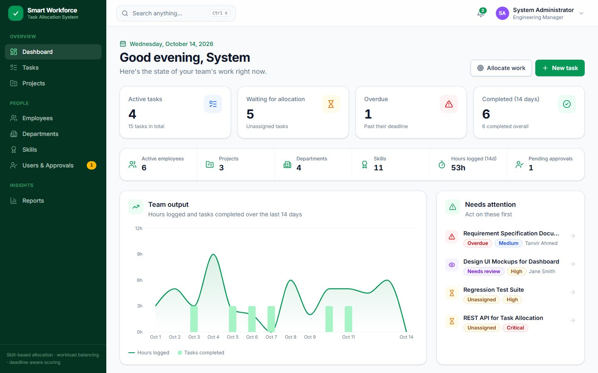

</div>

---

## Table of contents

- [Why this project](#why-this-project)
- [Screenshots](#screenshots)
- [Features](#features)
- [Quick start](#quick-start)
- [Deploy to Vercel](#deploy-to-vercel)
- [Demo accounts](#demo-accounts)
- [Architecture](#architecture)
- [Smart allocation algorithm](#smart-allocation-algorithm)
- [Task lifecycle](#task-lifecycle)
- [E-mail system](#e-mail-system)
- [Database](#database)
- [Security highlights](#security-highlights)
- [Project structure](#project-structure)
- [Scripts](#scripts)
- [Environment variables](#environment-variables)
- [Testing](#testing)
- [Keyboard shortcuts](#keyboard-shortcuts)
- [Documentation](#documentation)
- [Troubleshooting](#troubleshooting)
- [Limitations and roadmap](#limitations-and-roadmap)
- [License](#license)

---

## Why this project

| Problem | Solution |
| --- | --- |
| Managers hand out tasks from memory, so the same few people get overloaded and skills get ignored. | A **scoring engine** ranks every eligible employee for a task and **explains each score**. |
| Nobody can see who is free, what is late, or where a task is stuck. | A **state machine** controls every status change. A **Kanban board**, dashboards and reports show the current state. |
| Changes happen silently. | Every action is recorded in an **audit history**. The people involved get **in-app notifications** and, if e-mail is enabled, **e-mails**. |

---

## Screenshots

<table>
  <tr>
    <td align="center" width="50%">
      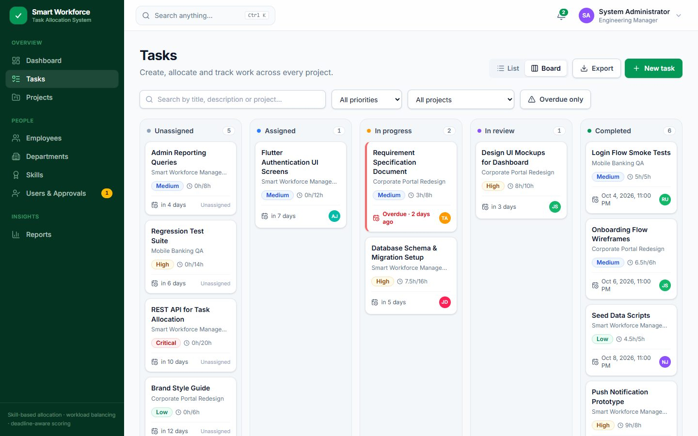<br>
      <sub><b>Kanban board</b>: the default tasks view, one column per status</sub>
    </td>
    <td align="center" width="50%">
      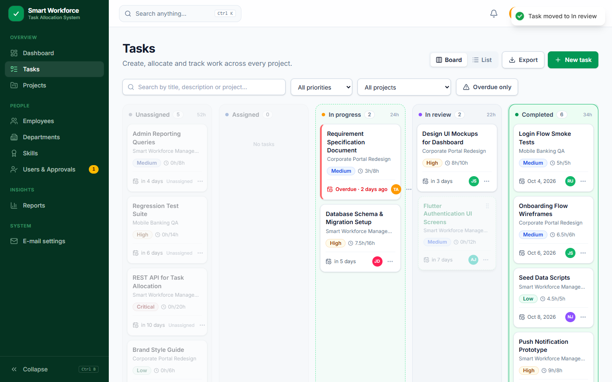<br>
      <sub><b>Drag and drop</b>: valid target columns light up while you drag</sub>
    </td>
  </tr>
  <tr>
    <td align="center" width="50%">
      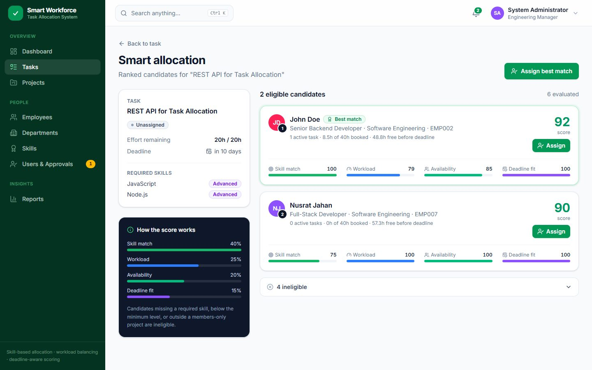<br>
      <sub><b>Smart allocation</b>: ranked candidates with a score breakdown</sub>
    </td>
    <td align="center" width="50%">
      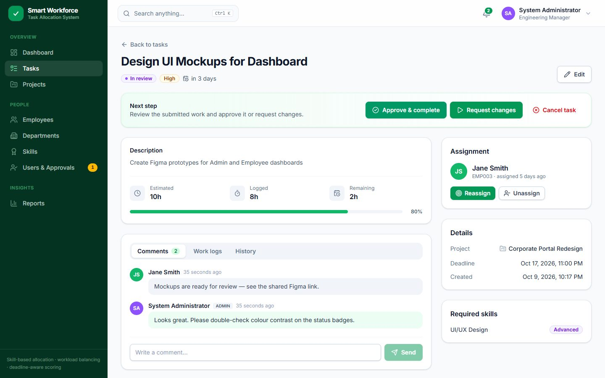<br>
      <sub><b>Task detail</b>: workflow actions, time logs, comments, files, history</sub>
    </td>
  </tr>
  <tr>
    <td align="center" width="50%">
      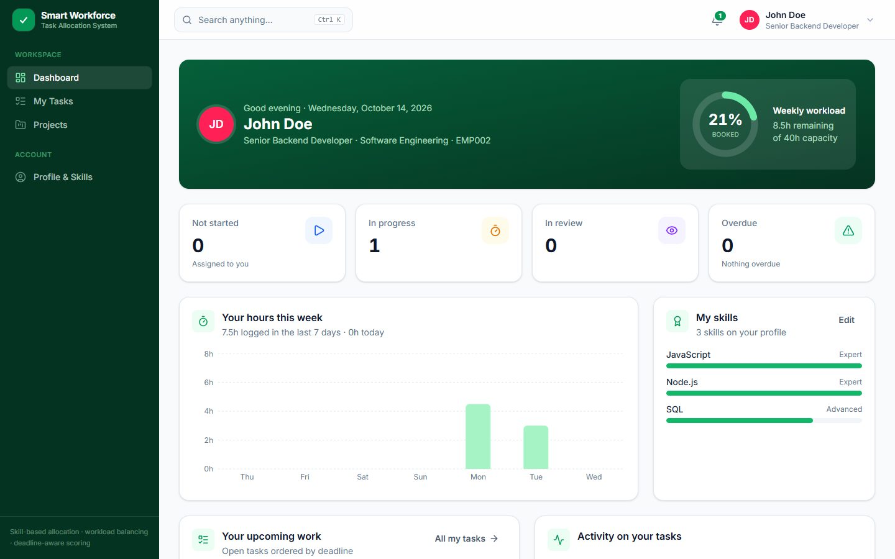<br>
      <sub><b>Employee profile</b>: skills, capacity and current workload</sub>
    </td>
    <td align="center" width="50%">
      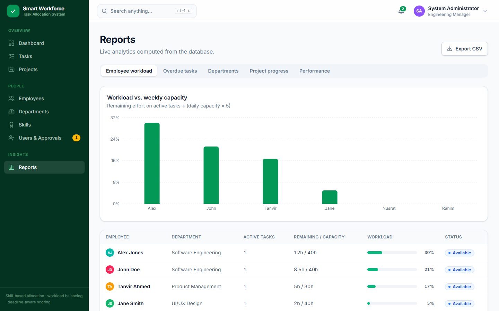<br>
      <sub><b>Reports</b>: workload, overdue work, utilisation, CSV export</sub>
    </td>
  </tr>
  <tr>
    <td align="center" width="50%">
      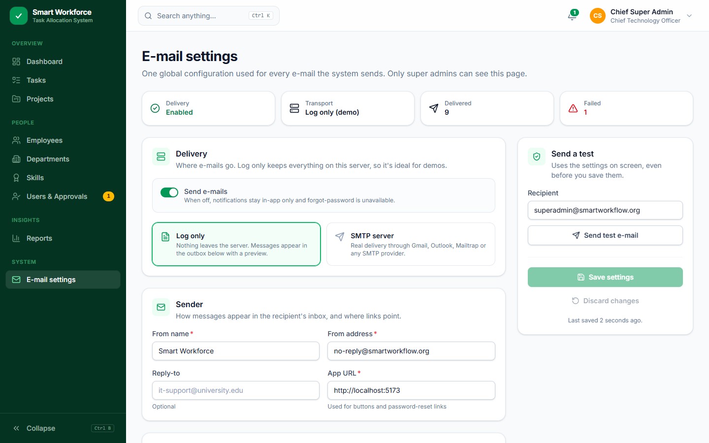<br>
      <sub><b>E-mail settings</b>: SMTP or LOG transport, per-event toggles, outbox</sub>
    </td>
    <td align="center" width="50%">
      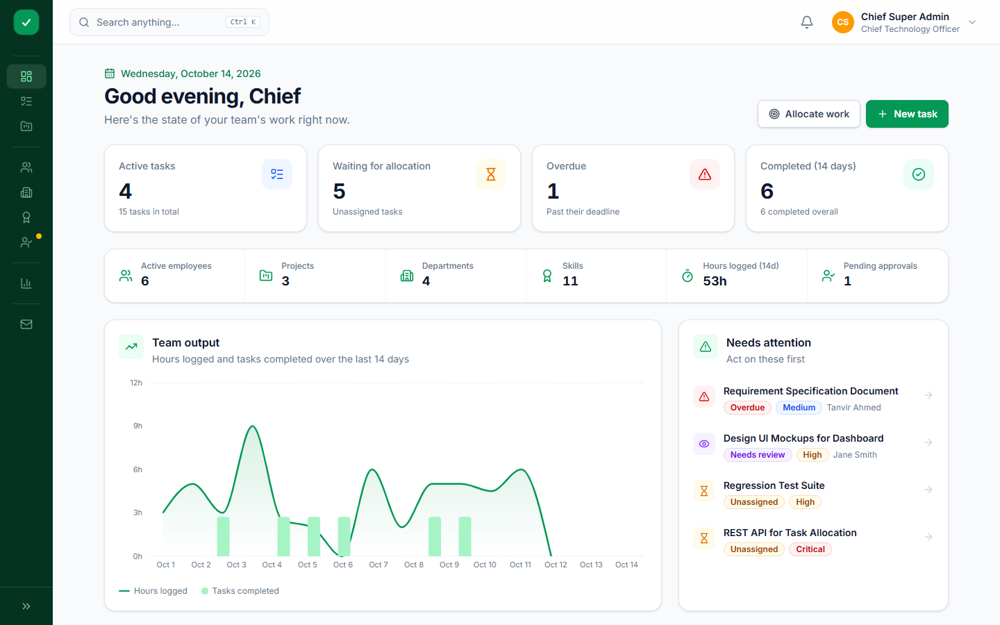<br>
      <sub><b>Collapsible sidebar</b>: resizable and remembered per browser</sub>
    </td>
  </tr>
  <tr>
    <td align="center" colspan="2">
      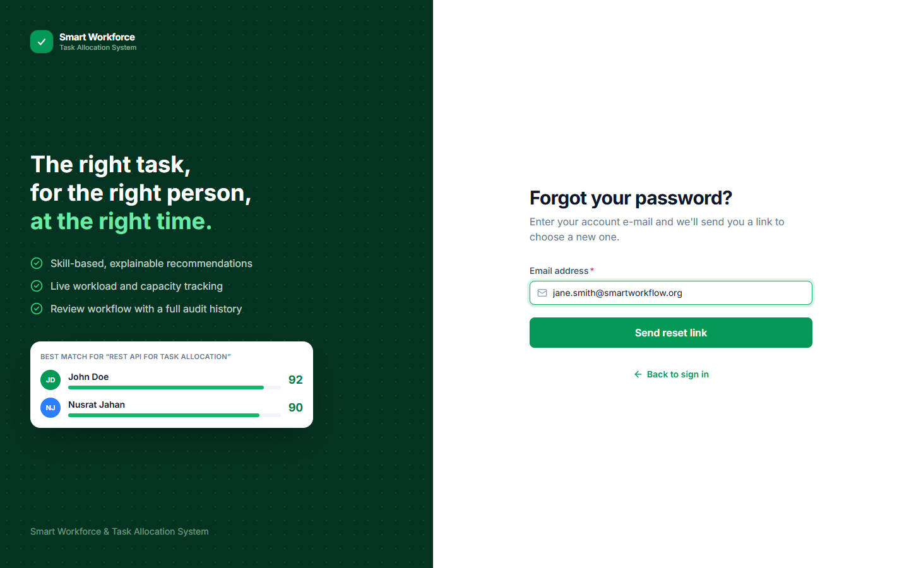<br>
      <sub><b>Forgot password</b>: one-time reset link sent by e-mail</sub>
    </td>
  </tr>
  <tr>
    <td align="center" colspan="2">
      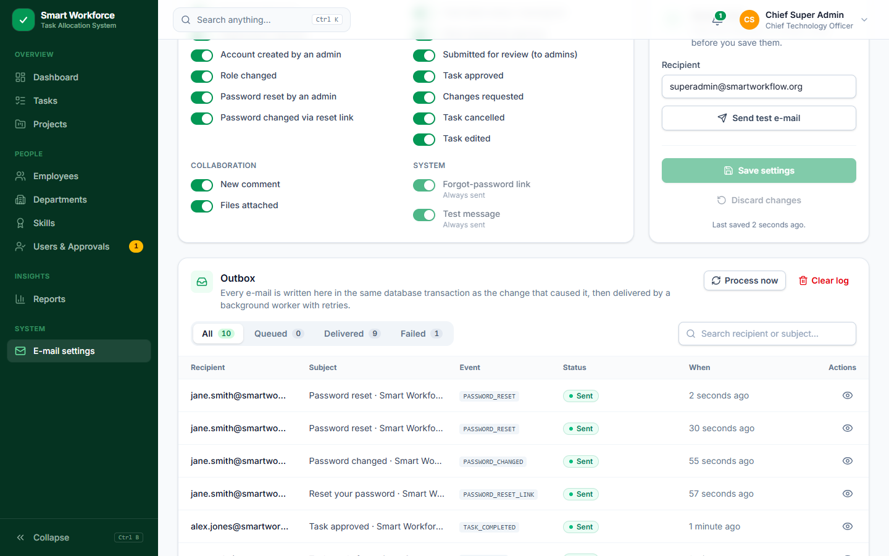<br>
      <sub><b>E-mail outbox</b>: every message with its event, status and retries, plus an HTML preview</sub>
    </td>
  </tr>
</table>

---

## Features

### 🎯 Smart allocation (engine v2)
- Ranked, **explainable** recommendations from five scores: skill fit 35 %, deadline fit 25 % (earliest-deadline-first schedule simulation), workload balance 20 %, focus 10 %, fairness 10 %.
- Every recommendation shows **insights** (projected finish, buffer, tasks it would push past their deadline, utilisation) and a **confidence** badge (Clear, Good, Close call, Only option).
- **Hard eligibility filters** run before scoring: approved and active employee, every required skill at or above the minimum level, and project membership when the project requires it.
- **Assign best match** picks the top eligible candidate in one atomic step.
- **Auto-allocate** plans every pending task at once (regret-based batch planner): preview the plan, then apply it in one transaction.
- **Reassign** with a reason, **unassign**, and an admin **override** (`force`) that allows assigning an ineligible employee.
- A **magic wand** icon marks only the decisions made by the algorithm (best match, confidence, auto-allocate, `AUTO_ASSIGNED` history), never decoration.

### 🗂️ Tasks and workflow
- Status workflow: Unassigned → Assigned → In progress → Review → Completed, plus cancel and reopen. The server checks the user's role for every transition and records it in the task history.
- **Kanban board is the default tasks view.** A list view is also available, and the app remembers which one you chose.
  - Drag and drop, with **valid target columns highlighted**.
  - **Optimistic moves**: a card moves at once and goes back if the server rejects the change.
  - A **"Move to" menu** on every card for touch screens and keyboard users.
  - Dropping an unassigned task on **Assigned** opens the smart allocation page.
- Logging the first hours of work on an Assigned task moves it to In progress automatically.

### 💬 Collaboration
- Comments, time logging (work logs) and an in-app notification centre.
- **File attachments** (multer): drag and drop, previews, type whitelist, up to **5 files of 10 MB** each per upload (the size limit is configurable).

### 👥 People and access
- Self-registration that needs **admin approval**. Admins can also create accounts directly.
- Three roles: **Super Admin**, **Admin**, **Employee**. Only super admins can change roles, and the **last active super admin** cannot be demoted or deactivated.
- Admins can reset a user's password. Users can upload a **profile photo** (PNG, JPEG, GIF or WebP, up to 2 MB).
- Employee skills with proficiency levels, daily capacity, departments, and projects with optional **members-only allocation**.

### 📧 E-mail and passwords
- A super admin configures **global e-mail at runtime** (Settings → E-mail settings, `/app/settings/email`) with no restart. The page offers SMTP presets for Gmail, Outlook, Mailtrap and Brevo, and a **LOG** transport for demos.
- The SMTP password is stored **encrypted with AES-256-GCM**.
- Each event type can be switched on or off. A **send test** button works with settings you have not saved yet.
- **Transactional outbox** with a background worker, automatic retries with backoff, manual retry, and an HTML **preview** of every message.
- **Forgot password by e-mail**: a one-time token where only its SHA-256 hash is stored, valid for 30 minutes.
- **Session revocation**: changing or resetting a password signs out every older session.

### 📊 Dashboards and reports
- Live KPIs, a needs-attention list, a 14-day output trend and an activity feed.
- Reports on workload, overdue tasks, department utilisation, project progress and on-time performance.
- **CSV export** on the tasks and reports pages.

### ⚡ Usability
- **Command palette** (`Ctrl + K`) to jump to any task, project, employee or page.
- **Resizable, collapsible sidebar** that the browser remembers (`Ctrl + B`).
- **Infinite lists**: tasks (list view), employees, users, notifications, task history and the e-mail outbox load one page at a time (20–50 rows) as you scroll, with a "Load more" button as a fallback.
- **One-click demo login** on the landing and login pages, with copyable credentials.
- Responsive layout for desktop and mobile.

### 🧯 Error handling
- API: every failure is a JSON envelope with a meaningful status (400 malformed JSON, 404 unknown route, **405 with an `Allow` header**, 409 duplicates, 413 too large, 415 bad charset, 500 with a **reference id** and no stack trace outside development).
- UI: **error boundaries** (whole app and per page), a 403 page for admin-only routes, an **offline / server-unreachable banner**, one toast for unexpected failures, a "session expired" message on 401, and an automatic one-time reload when a new deployment replaced the page's code chunks.

### 🛠️ Engineering
- **Versioned database migrations** (currently **v5**). The database file is **backed up automatically** before every upgrade.
- `npm run db:status`, `db:migrate` and `db:reset`.
- Optional **pagination** (`limit`/`offset`, total in `X-Total-Count`) on every large list, backward compatible.
- 157 Jest + supertest integration tests in 12 files, each test file using an in-memory database.

---

## Quick start

**Requirements:** Node.js 20 or newer, and npm. You don't need to install a database: SQLite is embedded.

```bash
# 1. Install everything: one npm workspace, one lockfile (Windows: double-click setup.bat)
npm install

# 2. Start the API and the React dev server together
npm run dev
```

| What | URL |
| --- | --- |
| Web app (Vite dev server) | http://localhost:5173 |
| REST API | http://localhost:5000/api |
| Health check | http://localhost:5000/api/health |

On first start the backend creates `backend/data/smart_workflow.db`, runs all migrations and loads the demo data. You don't need a `.env` file for local development, because every setting has a default (see [Environment variables](#environment-variables)).

### Production mode (single server)

```bash
npm run build   # builds the React app into frontend/dist
npm start       # Express serves the API and the built app on one port
```

Then open **http://localhost:5000**. For a real deployment, set `NODE_ENV=production` in the host's environment (never in `.env`) and a random `JWT_SECRET` of at least 32 characters in the root `.env`.

---

## Deploy to Vercel

The repository deploys as **one Vercel project**: the CDN serves the React build and `/api/*` goes to one serverless function ([`api/index.mjs`](api/index.mjs), the same Express app). `vercel.json` already holds the install, build, function and SPA-routing settings.

1. Push the repository to GitHub and import it in Vercel (**Add New → Project**). Keep the repo root as the root directory and the framework preset "Other".
2. Optional: add a `JWT_SECRET` environment variable.
3. Deploy, open the URL and sign in with any demo account (`password123`).

On Vercel the app runs as a **public demo** (`DEMO_MODE`, on by default there):

- The database is **always in memory** and is seeded on every cold start, so visitors can try everything, but **data is temporary** and parallel instances don't share changes.
- E-mail is LOG-only (SMTP is refused), the built-in `@smartworkflow.org` accounts can't have their password, role, status or profile changed, and uploads are off unless `DEMO_ALLOW_UPLOADS=true`.
- A small "Public demo" notice is shown in the app and on the login page.

For a permanent deployment, use single-server mode on a host with a persistent disk. Details: [docs/ai/DEPLOYMENT.md](docs/ai/DEPLOYMENT.md).

---

## Demo accounts

Every seeded account uses the password **`password123`**. The login page also has one-click buttons for the first five accounts below.

| Role | Name | Email | Notes |
| --- | --- | --- | --- |
| Super Admin | Chief Super Admin | `superadmin@smartworkflow.org` | Full control, role changes, e-mail settings |
| Admin | System Administrator | `admin@smartworkflow.org` | Tasks, allocation, approvals, reports |
| Employee | John Doe | `john.doe@smartworkflow.org` | Senior backend developer, one task in progress |
| Employee | Jane Smith | `jane.smith@smartworkflow.org` | Lead UI/UX designer, work waiting for review |
| Employee | Nusrat Jahan | `nusrat.jahan@smartworkflow.org` | Full-stack developer with free capacity |
| Employee | Alex Jones | `alex.jones@smartworkflow.org` | Flutter mobile developer |
| Employee | Rahim Uddin | `rahim.uddin@smartworkflow.org` | QA engineer (7 h/day capacity) |
| Employee | Tanvir Ahmed | `tanvir.ahmed@smartworkflow.org` | Product analyst (6 h/day capacity) |
| Employee | Sarah Khan | `sarah.khan@smartworkflow.org` | **Pending approval**: use it to try the approval flow |

---

## Architecture

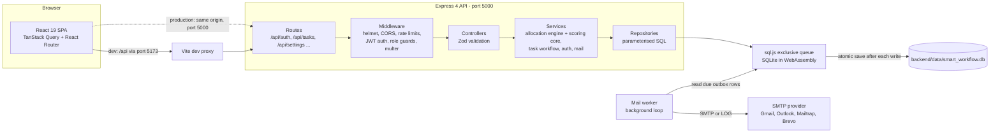

| Layer | Responsibility |
| --- | --- |
| **Routes** | Map URLs to controllers and attach the middleware each route needs (`authenticate`, `requireAdmin`, `requireSuperAdmin`, upload handlers, auth rate limiter). |
| **Middleware** | Security headers, CORS, rate limiting, JWT verification (the account is **re-loaded on every request**, so role changes and deactivation take effect immediately), file upload checks, 404/405 and central error handling. |
| **Controllers** | Parse and validate input with Zod (including optional `limit`/`offset` paging), call a service, shape the JSON response. |
| **Services** | Business rules: the allocation engine (with the pure, dependency-free scoring core `allocationScoring.js`), the task state machine, authentication and password reset, e-mail delivery. Multi-step changes run in **one transaction**. |
| **Repositories** | All SQL lives here, always with bound parameters. |
| **sql.js queue** | sql.js keeps the whole database in memory. One exclusive queue makes sure an async transaction never interleaves with another request. After each committed write, the database is saved to disk atomically (write a temp file, then rename it). |
| **Mail worker** | Started by `server.js`. It wakes when a message is queued and also polls every 15 s for retries. On Vercel there are no timers: `api/index.mjs` delivers queued mail right after it is queued. |

---

## Smart allocation algorithm

Scoring core (pure, no imports): [`backend/src/services/allocationScoring.js`](backend/src/services/allocationScoring.js). Data loading and explanations: [`allocationEngine.js`](backend/src/services/allocationEngine.js). Full derivation: [docs/ai/ALLOCATION_ENGINE.md](docs/ai/ALLOCATION_ENGINE.md).

**Stage 1: hard filters.** If a candidate fails any filter, they are marked ineligible with score 0 and the reasons are listed.

1. The account is an approved, active `EMPLOYEE` with an active employee profile.
2. The candidate has **every** required skill at or above the minimum proficiency (Beginner 25, Intermediate 50, Advanced 75, Expert 100).
3. If the project is members-only, the candidate is a project member.

**Stage 2: five explainable scores (0–100)** for eligible candidates.

| Component | Weight | How it is computed |
| --- | ---: | --- |
| **Skill fit** | 35 % | Per skill, how far above the minimum the person is (0–1), compared with a target set by priority: Critical 1.0, High 0.75, Medium 0.5, Low 0.25. 100 at the target, 75 at the furthest point. Experts go to critical work; routine work goes to someone comfortably qualified. |
| **Deadline fit** | 25 % | Simulates the person's queue in **earliest-deadline-first** (EDF) order with the new task. On time: 70–100 by the buffer left. Late: 0–60 by how late. **−15 for every existing task it would push past its deadline.** |
| **Workload balance** | 20 % | `100 · (1 − utilisation)` over the working days until the deadline (clamped to 5–20 days), using remaining hours. |
| **Focus** | 10 % | `100 − 15 · active tasks`, +10 if the person already works on the same project. |
| **Fairness** | 10 % | `100 / (1 + 0.5 · Σ e^(−age/7))` over assignments in the last 30 days, so recent picks count more than old ones. |

`total = 0.35 × skill + 0.25 × deadline + 0.20 × workload + 0.10 × focus + 0.10 × fairness`

EDF (Jackson's rule) minimises the maximum lateness on a single worker, so it is a realistic model of how a person orders their work. Each recommendation also returns **warnings**, **insights** (projected finish, buffer, displaced tasks, utilisation) and a **confidence** level from the margin to the runner-up (`CLEAR` ≥ 10, `GOOD` ≥ 4, `CLOSE` < 4, `ONLY_OPTION`). Ties are broken by precise score, then larger buffer, then name.

**Example (seed task 4, "REST API for Task Allocation", CRITICAL):** John Doe **86.9** beats Nusrat Jahan **83.3** (CLOSE, margin 3.6). Critical work targets full expertise, so John (Expert) gets skill fit 100 and Nusrat (exactly at the minimum) 75. Nusrat wins on workload, focus and fairness, but not by enough.

**Stage 3: batch planning (Auto-allocate).** Assigning pending tasks one by one in list order lets an easy task take the only specialist a harder task needed. The planner uses **regret-based greedy** ordering: each round it picks the task with the largest gap between its best and second-best candidate (plus a priority and deadline bonus), assigns it, and re-scores only the tasks whose top two included that person. `POST /api/tasks/auto-allocate` with `{ "dryRun": true }` previews the plan; without it, the plan is applied in **one transaction** and recorded as `AUTO_ASSIGNED`.

| Tasks × people | Planner (incremental top-2) | First draft (full re-scan every round) | Avg. score: planner / in-order greedy |
| --- | --- | --- | --- |
| 50 × 100 | 15 ms | 38 ms | 89.7 / 89.4 |
| 200 × 300 | 108 ms | 2.3 s | 87.0 / 86.6 |
| 500 × 1,000 | 0.65 s | 94 s | 88.3 / 88.1 |

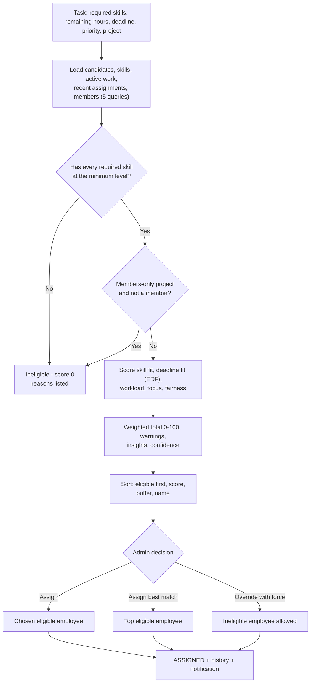

---

## Task lifecycle

The diagram matches `TRANSITIONS` in [`backend/src/services/taskService.js`](backend/src/services/taskService.js). The allocation endpoints (`assign`, `auto-assign`, and `auto-allocate` for many tasks at once) move a task from `PENDING` to `ASSIGNED`.

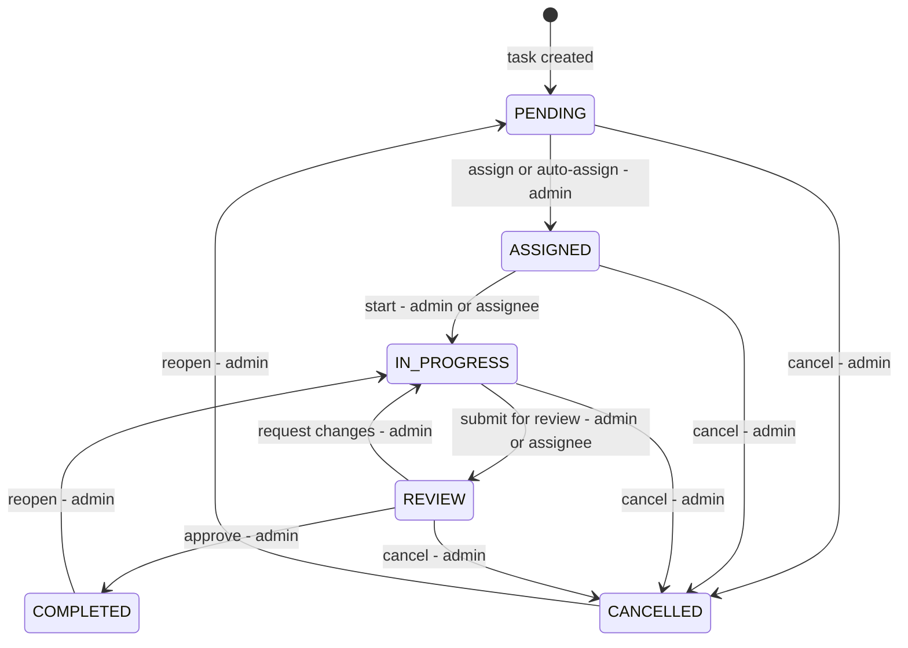

| Rule | Detail |
| --- | --- |
| Who may move a task | `admin` = Admin or Super Admin. `assignee` = the employee currently assigned. Everything else returns **403**. |
| Invalid transitions | Rejected with **400**, for example `PENDING → COMPLETED`. |
| Unassign | An admin can unassign a task that is not completed or cancelled. It goes back to `PENDING`. |
| Reassign | Keeps the current status, so in-flight work stays in progress. A reason is recorded. |
| First work log | Logging hours on an `ASSIGNED` task moves it to `IN_PROGRESS`. |
| Editing and deleting | Completed or cancelled tasks cannot be edited. Only `PENDING` or `CANCELLED` tasks can be deleted. |
| Audit | Every change writes a `task_history` row and notifies the people involved. |

The Kanban board uses the same rules to highlight valid drop targets. The server still enforces them.

---

## E-mail system

A super admin configures e-mail in the app at **Settings → E-mail settings** (`/app/settings/email`). There are no SMTP variables in `.env`.

| Setting | Meaning |
| --- | --- |
| **Enabled** | Master switch. When it is off, no e-mails are queued and forgot-password is unavailable. |
| **Transport** | `SMTP` delivers for real. `LOG` (the default) sends nothing outside the server: messages are marked sent and can be previewed in the outbox. LOG is ideal for demos and vivas. |
| **SMTP host, port, TLS, user, password** | One-click presets for Gmail, Outlook / Office 365, Mailtrap and Brevo. The password is stored **AES-256-GCM encrypted**, with a key derived from `SETTINGS_SECRET`. |
| **From name, from address, reply-to, app URL** | Message headers, and the base URL used for links inside e-mails. |
| **Events** | Turn each event on or off: account events, task events, comments and attachments. Forgot-password links and test messages are always sent. |
| **Send test** | Sends right away using the form's current values, **even if not saved yet**, and shows the real SMTP error if it fails. |
| **Outbox** | Search and filter by status, preview the HTML, retry failed messages, flush now, clear. |

### Transactional outbox

E-mails are written to `email_outbox` **inside the same transaction** as the change that caused them. If a request is rolled back, no e-mail is sent. The network call to the SMTP server happens later and outside the request, so a slow mail server never blocks the API.

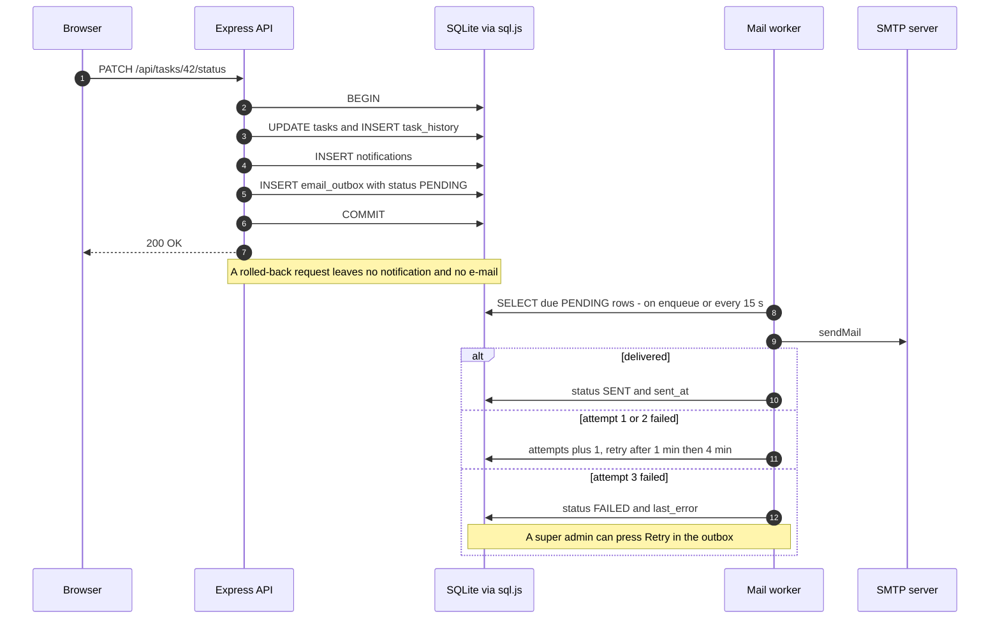

### Setting up Gmail

1. Turn on **2-Step Verification** for the Google account, then create an **App password** (Google Account → Security → App passwords).
2. In the app, sign in as `superadmin@smartworkflow.org` and open **Settings → E-mail settings**.
3. Choose **SMTP**, then click the **Gmail** preset (`smtp.gmail.com`, port 587, STARTTLS).
4. Username = your Gmail address. Password = the 16-character app password. From address = the same Gmail address.
5. Set **App URL** to where users open the app (`http://localhost:5173` in development, `http://localhost:5000` in single-server mode).
6. Press **Send test**. When it arrives, switch **Enabled** on and **Save**.

**For a demo without a real mailbox**, choose **LOG**, enable it and save. Every message then appears in the outbox with a full preview. **Mailtrap** is another option: it catches real SMTP traffic in a test inbox.

### Forgot password and session revocation

- **Forgot password** is only offered while e-mail is enabled. The response is the same whether or not the address exists, so the form cannot be used to discover accounts. The link has a random one-time token. **Only its SHA-256 hash is stored**, and it expires after `PASSWORD_RESET_TTL_MINUTES` (default 30). Requesting a new link invalidates older ones, and using a link consumes every outstanding token for that user.
- **Session revocation**: every password change or reset sets `users.password_changed_at`. The auth middleware rejects any JWT whose `iat` (issued-at time) is earlier than that. A user who changes their own password gets a fresh token, so they stay signed in on that device.

---

## Database

SQLite runs in-process through **sql.js** (SQLite compiled to WebAssembly). Data is stored in `backend/data/smart_workflow.db` (on Vercel the database is always in memory and reseeded on each cold start).

```mermaid
erDiagram
    users ||--o| employees : "has profile"
    departments ||--o{ employees : employs
    departments ||--o{ projects : owns
    employees ||--o{ employee_skills : has
    skills ||--o{ employee_skills : "rated in"
    users ||--o{ projects : creates
    projects ||--o{ project_members : has
    employees ||--o{ project_members : joins
    projects ||--o{ tasks : contains
    tasks ||--o{ task_skills : requires
    skills ||--o{ task_skills : "required by"
    tasks ||--o{ task_assignments : "assigned via"
    employees ||--o{ task_assignments : receives
    tasks ||--o{ work_logs : "time spent"
    employees ||--o{ work_logs : logs
    tasks ||--o{ comments : has
    users ||--o{ comments : writes
    tasks ||--o{ task_history : "audited by"
    users ||--o{ task_history : performs
    tasks ||--o{ attachments : has
    users ||--o{ attachments : uploads
    users ||--o{ notifications : receives
    users ||--o{ email_outbox : "mailed to"
    users ||--o{ password_resets : requests
    users ||--o{ email_settings : "last updated"

    users {
        int id PK
        text email UK
        text password_hash
        text role "SUPER_ADMIN ADMIN EMPLOYEE"
        text approval_status "PENDING APPROVED REJECTED"
        int is_active
        text avatar_file "v3"
        text password_changed_at "v4, repaired by v5"
    }
    employees {
        int id PK
        int user_id FK
        text employee_code UK
        text full_name
        int department_id FK
        text job_position
        real daily_capacity_hours
    }
    departments {
        int id PK
        text name UK
    }
    skills {
        int id PK
        text name UK
        text category
    }
    employee_skills {
        int employee_id PK
        int skill_id PK
        text proficiency_level
        int numeric_score "generated"
    }
    projects {
        int id PK
        text name
        int department_id FK
        int requires_membership
        int is_archived
        int created_by FK
    }
    project_members {
        int project_id PK
        int employee_id PK
    }
    tasks {
        int id PK
        int project_id FK
        text title
        text priority
        real estimated_hours
        text deadline
        text status
        text completed_at "v2"
    }
    task_skills {
        int task_id PK
        int skill_id PK
        text min_proficiency_level
        int min_numeric_score "generated"
    }
    task_assignments {
        int id PK
        int task_id FK
        int employee_id FK
        int assigned_by FK
        int is_current "one current per task"
        text reassignment_reason
    }
    work_logs {
        int id PK
        int task_id FK
        int employee_id FK
        text work_date
        real hours_worked
    }
    comments {
        int id PK
        int task_id FK
        int user_id FK
        text content
    }
    task_history {
        int id PK
        int task_id FK
        int actor_id FK
        text action
        text details
    }
    notifications {
        int id PK
        int user_id FK
        text title
        text type
        int is_read
    }
    attachments {
        int id PK
        int task_id FK
        int uploaded_by FK
        text original_name
        text stored_name UK
        int size_bytes
    }
    email_settings {
        int id PK "always 1"
        int enabled
        text transport "SMTP or LOG"
        text smtp_host
        text smtp_password_enc "AES-256-GCM"
        text disabled_events "JSON"
        int updated_by FK
    }
    email_outbox {
        int id PK
        int user_id FK
        text to_email
        text event_type
        text status "PENDING SENT FAILED"
        int attempts
        text next_attempt_at
    }
    password_resets {
        int id PK
        int user_id FK
        text token_hash UK "SHA-256"
        text expires_at
        text used_at
    }
```

### Migrations

The schema version is stored in `PRAGMA user_version`. Each migration runs once, in order, inside its own transaction. Before upgrading an existing file, the server copies it to `backend/data/backups/`.

| Version | Adds |
| --- | --- |
| **v1** | Base schema: departments, users, employees, skills, employee_skills, projects, project_members, tasks, task_skills, task_assignments, work_logs, task_history, comments, notifications, and their indexes. |
| **v2** | `tasks.completed_at`. A unique index that allows only **one current assignment per task**. Extra indexes. A repair of the legacy seed password hash. |
| **v3** | `users.avatar_file` and the `attachments` table (file uploads). |
| **v4** | `users.password_changed_at` (session revocation), `email_settings` (one row), `email_outbox`, `password_resets`. |
| **v5** | Repair: adds `users.password_changed_at` to databases that ran an early build of migration 4 (no-op otherwise). |

| Command | Effect |
| --- | --- |
| *(automatic on start)* | Creates the database if it is missing, applies pending migrations (after a backup), and seeds demo data if there are no users |
| `npm run db:status` | Read-only: shows the file's schema version and any pending migrations |
| `npm run db:migrate` | Backs up the file, applies pending migrations, and prints row counts per table |
| `npm run db:reset` | **Wipes** the database and reseeds the demo data |

> Only one server process should use a database file at a time. A running server keeps the database in memory and overwrites manual edits to the file.

---

## Security highlights

| Area | Measure |
| --- | --- |
| Passwords | bcrypt hashes (`BCRYPT_ROUNDS`, default 10). Minimum length 6, maximum 128. |
| Authentication | JWT bearer tokens. The account is re-loaded on every request, so deactivation, approval changes and role changes apply immediately. |
| Session revocation | Tokens issued before `password_changed_at` are rejected. |
| Password reset | Random one-time token. Only its SHA-256 hash is stored. 30-minute expiry. The response does not reveal whether an account exists. |
| Secrets at rest | SMTP password encrypted with AES-256-GCM. A copied `.db` file alone does not reveal it. |
| Authorisation | Role guards on routes. Employees only see tasks they are or were assigned to. Only super admins manage roles and e-mail settings. Admins cannot manage super admin accounts. The last active super admin cannot be demoted or deactivated. |
| Input validation | Zod schemas on every write endpoint. JSON body limit of 100 kB. |
| SQL injection | Parameterised queries in every repository. |
| Uploads | MIME type and file extension must both be on a whitelist. Files are stored under random names. Size and count limits apply. Attachment downloads check task access. |
| HTTP hardening | `helmet` security headers, `x-powered-by` disabled, strict CORS allow-list in production. |
| Rate limiting | Login, registration and password reset: 50 per 15 min. Whole API: 600 per minute. `trust proxy` behind Vercel (or `TRUST_PROXY=true`) so limits see the real client IP. |
| Errors | Unexpected errors return a generic message and a short `reference` id that is also logged. Stack traces are only included in development. |
| Production guard | The server refuses to start in production without a `JWT_SECRET` of at least 32 characters (public demo mode uses a fallback, because its accounts and passwords are public anyway). |
| Public demo | Built-in accounts can't be locked or taken over, SMTP is refused, uploads are off by default. |

---

## Project structure

```text
smart_workflow/
├── package.json             # npm workspaces (backend, frontend) + root scripts
├── package-lock.json        # the only lockfile
├── .env.example             # the only config template (copy to .env, git-ignored)
├── vercel.json              # Vercel: build, API function, SPA routing
├── api/index.mjs            # Vercel serverless entry: exports the Express app
├── setup.bat                # Windows one-click install (npm install)
├── backend/
│   ├── data/                # smart_workflow.db (+ backups/ before migrations)
│   ├── uploads/             # attachments/ and avatars/ (git-ignored)
│   ├── src/
│   │   ├── app.js           # Express app: middleware, routes, static frontend
│   │   ├── server.js        # starts HTTP server + mail worker, graceful shutdown, crash handlers
│   │   ├── config/          # env (reads root .env), db (sql.js queue), schema (migrations), seed, status, migrate
│   │   ├── routes/          # auth, admin, tasks, projects, employees, reports, settings ...
│   │   ├── middleware/      # authMiddleware, rateLimiters, upload, errorHandler, notFoundHandler (404/405)
│   │   ├── controllers/     # one per resource, incl. emailSettingsController
│   │   ├── services/        # allocationScoring (pure core), allocationEngine, taskService, authService, mailService, dashboardService
│   │   ├── repositories/    # all SQL, incl. emailRepository
│   │   ├── validators/      # Zod schemas
│   │   └── utils/           # errors, dates, pagination, demo guards, emailTemplates, secretBox (AES-GCM, SHA-256)
│   └── tests/               # 12 Jest + supertest suites, helpers, setupEnv
├── frontend/
│   ├── public/screenshots/  # images used in this README
│   ├── vite.config.js       # dev server :5173, /api proxy to :5000, envDir '..' (root .env, VITE_* only)
│   └── src/
│       ├── App.jsx          # routes and role guards (403 page, 404 page)
│       ├── components/      # ui kit (+ LoadMore), TaskCard, CommandPalette, ErrorBoundary, NetworkStatus,
│       │                    # MagicBadge, DemoNotice, layout/ (AppLayout, useSidebar)
│       ├── context/         # AuthContext
│       ├── lib/             # api client, endpoints, usePagedQuery, chunkReload, csv, demo accounts, formatting
│       └── pages/           # public/, dashboard/, tasks/ (incl. AutoAllocateModal), projects/, employees/,
│                            # admin/, reports/, settings/, departments/, skills/ ...
├── docs/
│   ├── ai/                  # current engineering documentation
│   └── qa/                  # viva questions and answers
├── database/  sql/          # reference SQL from the original design
```

---

## Scripts

Run everything from the repository root. The root `package.json` is an npm workspace (`backend`, `frontend`), so one `npm install` installs both and there is one `package-lock.json`.

| Script | Action |
| --- | --- |
| `npm install` (or `npm run setup`) | Install all dependencies |
| `npm run dev` | Run the API (`node --watch`) and the Vite dev server together |
| `npm run build` | Build the React app into `frontend/dist` |
| `npm start` | Start the API. It also serves `frontend/dist` if that has been built. |
| `npm test` | Run the backend integration tests |
| `npm run lint` | Lint the frontend (oxlint) |
| `npm run check` | Tests + lint + production build: run before pushing |
| `npm run db:status` | Show the database schema version and pending migrations |
| `npm run db:migrate` | Back up the database and apply pending migrations |
| `npm run db:reset` | Wipe and reseed the database |
| `npm run vercel-build` | Alias of `build` for Vercel |

A single workspace can be targeted with `-w`, e.g. `npm run dev -w backend` or `npm run preview -w frontend`. Requires Node.js 20 or newer.

---

## Environment variables

There is **one** config file for the whole repository: the root `.env` (copy [`.env.example`](.env.example); `.env` is git-ignored). The backend reads every key ([`backend/src/config/env.js`](backend/src/config/env.js)); Vite reads the same file (`envDir: '..'`) but only exposes `VITE_*` keys to the browser. Variables already set in the environment win, which is how Vercel and the tests configure the app. Every variable is optional for local development.

| Variable | Default | Meaning |
| --- | --- | --- |
| `PORT` | `5000` | API port |
| `NODE_ENV` | `development` | Set by the host or shell, **never in `.env`** (Vite would bundle React's development build). `production` requires a strong `JWT_SECRET` and enables strict CORS. Tests set `test`. |
| `DB_FILE` | `smart_workflow.db` | File name in `backend/data/`, or `:memory:` for a throw-away database. Ignored on Vercel (always in memory). |
| `JWT_SECRET` | dev fallback | Token signing key. **Required (32+ characters) in production.** |
| `JWT_EXPIRES_IN` | `24h` | Token lifetime |
| `BCRYPT_ROUNDS` | `10` | Password hashing cost |
| `ALLOWED_ORIGINS` | localhost list | Comma-separated CORS allow-list (enforced in production only) |
| `UPLOAD_DIR` | `uploads` | Where attachments and photos are stored, relative to `backend/` (temp dir on Vercel) |
| `MAX_UPLOAD_MB` | `10` (4 on Vercel) | Per-file attachment limit. Profile photos are always 2 MB or less. |
| `SETTINGS_SECRET` | value of `JWT_SECRET` | Key material for encrypting the stored SMTP password. **If you change it, re-enter the SMTP password.** |
| `EMAIL_WORKER` | on | Set to `off` to disable the background mail worker. The outbox can still be flushed from the UI. Always off under tests. |
| `PASSWORD_RESET_TTL_MINUTES` | `30` | How long a forgot-password link stays valid |
| `DEMO_MODE` | `true` on Vercel, else `false` | Public demo mode (see [Deploy to Vercel](#deploy-to-vercel)) |
| `DEMO_ALLOW_UPLOADS` | `false` | Allow uploads in demo mode |
| `TRUST_PROXY` | `true` on Vercel | Read the client IP from `X-Forwarded-For` behind a proxy |
| `VITE_API_PROXY_TARGET` | `http://localhost:5000` | Vite dev proxy target |
| `VITE_API_BASE_URL` | `/api` | API URL for a separately hosted frontend build |

---

## Testing

```bash
npm test          # backend tests
npm run check     # tests + frontend lint + production build
```

- **157 integration tests** in 12 suites, written with **Jest + supertest**. They send real HTTP requests to the Express app.
- Each test file gets a fresh **in-memory** database seeded with the demo data, and a temporary upload folder. Your real `.db` file is never touched.
- The rate limiters and the mail worker are turned off under test, so results are deterministic.

| Suite | Tests | Covers |
| --- | ---: | --- |
| `access.test.js` | 18 | Unauthenticated requests are rejected (401). Role-based access control. |
| `allocation.test.js` | 16 | Scoring core (EDF, expertise, fairness, batch planner), eligibility filters with live data, auto-allocate preview and apply |
| `auth.test.js` | 11 | Register, approve, log in, profile, change password |
| `crud.test.js` | 10 | Departments, skills, employees, projects |
| `demo.test.js` | 6 | Public demo mode: protected accounts, uploads off, LOG-only e-mail, no reset links for built-in accounts |
| `email.test.js` | 16 | E-mail settings (super admin only), encryption, outbox, forgot password, session revocation |
| `errors.test.js` | 18 | 400/401/403/404/405/409/413/415 mapping, 500 with reference and no stack |
| `health.test.js` | 1 | `GET /api/health` |
| `pagination.test.js` | 18 | `limit`/`offset`, `X-Total-Count`, `/tasks/summary`, invalid paging |
| `reports.test.js` | 10 | Reports, dashboard, notifications |
| `uploads.test.js` | 18 | Attachments, profile photos, role management |
| `workflow.test.js` | 15 | Full task lifecycle and transition rules |

Frontend checks: `npm run lint` (oxlint) and `npm run build`. The frontend has no automated UI tests.

---

## Keyboard shortcuts

| Shortcut | Where | Action |
| --- | --- | --- |
| `Ctrl + K` (`⌘ + K` on macOS) | Anywhere in the app | Open or close the command palette |
| `↑` `↓` `Enter` | Command palette | Move through results and open one |
| `Ctrl + B` (`⌘ + B`) | Anywhere in the app | Collapse or expand the sidebar |
| Drag the sidebar edge | Sidebar | Resize between 208 and 400 px. Drag far left to collapse it to an icon rail. |
| Double-click the edge | Sidebar | Reset to the default width |
| `←` `→` | Sidebar edge (focused) | Narrow or widen by 16 px |
| `Enter` / `Space` | Sidebar edge (focused) | Collapse or expand |
| `Home` | Sidebar edge (focused) | Reset to the default width |
| `Esc` | Dialogs, command palette, "Move to" menu | Close |

---

## Documentation

| Document | What it covers |
| --- | --- |
| [docs/ai/README.md](docs/ai/README.md) | Index and one-minute summary |
| [ARCHITECTURE.md](docs/ai/ARCHITECTURE.md) | Layers, request flow, design decisions |
| [AUDIT_REPORT.md](docs/ai/AUDIT_REPORT.md) | Defects found in the original code and how each was fixed |
| [ALLOCATION_ENGINE.md](docs/ai/ALLOCATION_ENGINE.md) | Allocation engine v2: scores, EDF, batch planner, benchmarks |
| [DEPLOYMENT.md](docs/ai/DEPLOYMENT.md) | One-repo structure, Vercel, public demo mode, configuration |
| [TASK_WORKFLOW.md](docs/ai/TASK_WORKFLOW.md) | State machine, permissions, notifications |
| [DATABASE.md](docs/ai/DATABASE.md) | Schema, relationships, migrations, seed data |
| [API_REFERENCE.md](docs/ai/API_REFERENCE.md) | Every endpoint, its access level and payload |
| [FRONTEND.md](docs/ai/FRONTEND.md) | React structure, routing, data fetching, UI kit |
| [RUNBOOK.md](docs/ai/RUNBOOK.md) | Install, run, test, reset, deploy, troubleshoot |
| [docs/qa/README.md](docs/qa/README.md) | Viva preparation: likely questions and answers |

---

## Troubleshooting

| Symptom | Fix |
| --- | --- |
| UI says "Cannot reach the server" | Start the backend. `npm run dev` at the root starts both halves. |
| `Port 5000 is already in use` | Stop the other process, or set `PORT` and `VITE_API_PROXY_TARGET` in the root `.env`. |
| Production build shows React development warnings | `NODE_ENV` was put in `.env`. Remove it; let the host or shell set it. |
| On Vercel, my changes disappeared | Expected in demo mode: the database is in memory and reseeded on each cold start. |
| "Public demo: … is disabled" (403) | Demo mode protects the built-in accounts and blocks SMTP and uploads. Register your own account, or set `DEMO_MODE=false` on a host with a persistent disk. |
| Demo login fails on an old database | Restart once (migration 2 repairs legacy passwords), or run `npm run db:reset`. |
| "Too many attempts" on login | Auth rate limit (50 per 15 min). Wait, or restart the server. |
| Forgot-password page says it is unavailable | E-mail is disabled. Enable it in Settings → E-mail settings (LOG is enough for a demo). |
| Test e-mail fails with Gmail | Use an **App password**, not your normal password, and port 587 with TLS off (STARTTLS). |
| Saved SMTP password stopped working | `SETTINGS_SECRET` (or `JWT_SECRET`) changed. Re-enter the password. |
| Signed out right after a password change elsewhere | This is expected: older sessions are revoked. Sign in again. |
| "File type not allowed" | Only images, PDF, text/CSV/JSON, ZIP and Office files are accepted. |
| Need to undo a migration | Stop the server, then copy the newest file from `backend/data/backups/` over `smart_workflow.db`. |

---

## Limitations and roadmap

**Known limitations**

- sql.js holds the whole database in memory and runs one write at a time. That suits a single-server demo, not heavy concurrent load.
- Only one server process should use a database file at a time.
- The JWT is kept in `localStorage`. There are no refresh tokens: a session lasts `JWT_EXPIRES_IN`.
- Notifications are not pushed in real time. The UI polls for them every 30 s.
- Uploads are stored on the server's local disk.
- The Vercel deployment is a demo: its in-memory data is temporary and not shared between instances.
- The allocation model ignores holidays and leave, and the batch planner is a strong heuristic, not a proven optimum.
- There are no automated frontend tests.

**Possible next steps**

- Move to a server database (PostgreSQL, MySQL or Turso/libSQL) behind the existing repository layer, which would also make the Vercel deployment persistent.
- Real-time updates with WebSockets or server-sent events.
- Calendar-aware availability (leave and holidays) in the allocation engine.
- Frontend component and end-to-end tests.

---

## Author

**MD. Habibullah Sharif**: full-stack developer. Website: [habibullah.dev](https://habibullah.dev) · GitHub: [@md8-habibullah](https://github.com/md8-habibullah)

If this project helped you, a ⭐ on [the repository](https://github.com/md8-habibullah/smart_workflow) is appreciated.

## License

Released under the [ISC license](LICENSE) © 2026 MD. Habibullah Sharif.

<div align="center">
<sub>Built with Express, sql.js, React, TanStack Query, Tailwind CSS and Recharts · crafted by <a href="https://habibullah.dev">Habibullah</a></sub>
</div>
