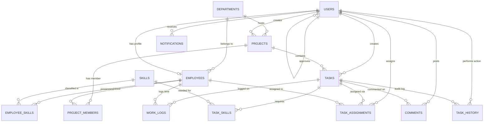

# Entity Relationship Diagram (ERD) & Relational Schema

## System Architecture ERD (Mermaid Diagram)

## Entity Descriptions

1. **DEPARTMENTS:** Stores organizational units (e.g. Software Engineering, UI/UX Design).
2. **USERS:** Stores login credentials, roles (`ADMIN`, `EMPLOYEE`), and approval status (`PENDING`, `APPROVED`, `REJECTED`).
3. **EMPLOYEES:** Stores full name, employee code, daily capacity hours (default 8.0), and job position.
4. **SKILLS:** Master list of technical and soft skills.
5. **EMPLOYEE_SKILLS:** Junction table storing employee skill proficiencies (`BEGINNER` = 25, `INTERMEDIATE` = 50, `ADVANCED` = 75, `EXPERT` = 100).
6. **PROJECTS:** Projects under departments containing tasks.
7. **PROJECT_MEMBERS:** Junction table for project membership.
8. **TASKS:** Tasks with priority, estimated hours, deadline, and status (`PENDING`, `ASSIGNED`, `IN_PROGRESS`, `REVIEW`, `COMPLETED`, `CANCELLED`).
9. **TASK_SKILLS:** Minimum required skill proficiency levels for a task.
10. **TASK_ASSIGNMENTS:** Active and historical employee task assignments.
11. **WORK_LOGS:** Daily hours logged by employees on assigned tasks.
12. **TASK_HISTORY:** Immutable audit trail for task creation, editing, assignment, reassignment, and status updates.
13. **COMMENTS:** Task discussion comments.
14. **NOTIFICATIONS:** In-app notifications for task assignments and status updates.
