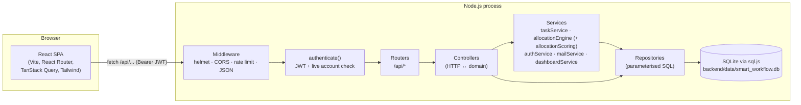
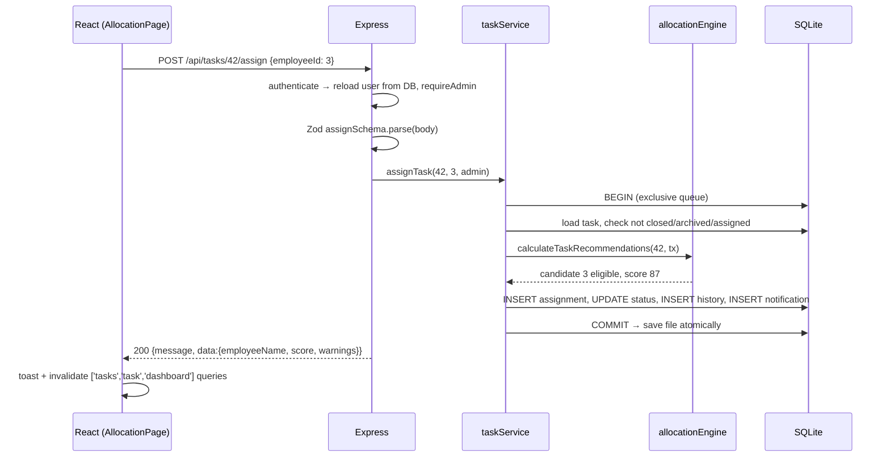

# Architecture

## 1. System overview



- **Development:** Vite serves the React app on `:5173` and proxies `/api` to Express on `:5000`, so there is no CORS friction.
- **Production (single server):** `npm run build` writes `frontend/dist`; Express detects it and serves the SPA from `:5000` with an `index.html` fallback for client-side routes. One process, one port.
- **Vercel:** two [services](https://vercel.com/docs/services) in `vercel.json`. `frontend` is the Vite build on the CDN, with an `index.html` fallback. `backend` is the Express app (`backend/src/app.js`) as a serverless function, which calls `enableOnDemandDelivery()` when `VERCEL` is set (no background timers on serverless). `/api/*` routes to `backend` and keeps its `/api` prefix. `VERCEL=1` switches on public demo mode (in-memory DB seeded per cold start). See [DEPLOYMENT.md](DEPLOYMENT.md).

## 2. Backend layers

| Layer | Folder | Responsibility | Must not |
| --- | --- | --- | --- |
| Routes | `src/routes` | URL → controller, attach `authenticate` / `requireAdmin` / `requireUploadsEnabled` | contain logic |
| Controllers | `src/controllers` | Parse + validate input (Zod, incl. optional `limit`/`offset`), call services/repos, shape the response, set `X-Total-Count` | write SQL |
| Services | `src/services` | Business rules: lifecycle transitions, eligibility, transactions, notifications. `allocationScoring.js` is the pure, import-free scoring core; `allocationEngine.js` loads data (5 queries) and explains scores | know about `req`/`res` |
| Repositories | `src/repositories` | One place per table group for SQL; every query parameterised | enforce permissions |
| Middleware | `src/middleware` | Auth, rate limiters, uploads, `notFoundHandler` (404 / 405 + `Allow`), `errorHandler` | |
| Config | `src/config` | Env (root `.env`, `isDemoMode()`), DB connection + queue, migrations, seed data | |
| Utils | `src/utils` | `AppError` helpers, `asyncHandler`, UTC date helpers, `pagination.js`, `demo.js` (public-demo guards), e-mail templates, `secretBox` | |

Every repository function takes an optional executor (`ex = defaultExecutor`). Passing the transaction object `tx` lets the **same** function run inside `withTransaction`, which keeps multi-step operations (assign = close old assignment + insert new + status + history + notifications) atomic.

### Response envelope

```json
{ "success": true, "message": "optional", "data": { } }
{ "success": false, "message": "Human readable", "errors": [{ "field": "deadline", "message": "…" }] }
```

Status codes: `400` validation/business rule/malformed JSON · `401` missing/invalid token · `403` role, ownership or public-demo restriction · `404` not found · `405` wrong method (with `Allow` header) · `409` conflict (duplicate, wrong state) · `413` body or file too large · `415` unsupported body charset/encoding · `500` unexpected.

List endpoints keep their body shape when paged; the total goes in the `X-Total-Count` header (CORS-exposed together with `Allow`).

### Error handling

- **Request errors:** controllers are wrapped in `asyncHandler`, so every rejection reaches [`errorHandler.js`](../../backend/src/middleware/errorHandler.js). It maps Zod (400 + field list), body-parser (400/413/415), multer (400/413), JWT (401), our `AppError`s and Express http-errors (4xx), and SQLite constraint failures (`UNIQUE` 409, `FOREIGN KEY`/`CHECK`/`NOT NULL` 400). Anything else is a 500 with a short `reference` id that is also logged; the stack is only included when `NODE_ENV=development`. Files written for a failed request are deleted.
- **Unknown routes:** [`notFoundHandler.js`](../../backend/src/middleware/notFoundHandler.js) walks the router stack: a known path with the wrong method gets **405** and an `Allow` header, otherwise a JSON **404**.
- **Process level** ([`server.js`](../../backend/src/server.js)): `unhandledRejection` is logged and the process keeps running; `uncaughtException` stops the mail worker, rolls back any open transaction, saves committed data and exits so a supervisor can restart it.

## 3. Request lifecycle (example: assign a task)



## 4. Key design decisions

| Decision | Why |
| --- | --- |
| **sql.js + single exclusive queue** | sql.js has one in-memory connection. Without serialisation, two requests could interleave inside an async transaction ("cannot start a transaction within a transaction"). `runExclusive` chains every statement and transaction on one promise queue; the DB file is written atomically (`.tmp` + rename) after each committed write. |
| **Versioned migrations (`PRAGMA user_version`)** | Existing databases upgrade in place. Migration 2 also repairs the broken legacy seed password hash. |
| **Auth re-checks the account on every request** | Tokens carry only `{id, role}`; `authenticate` reloads the user so deactivation, rejection or role changes take effect immediately, not when the token expires. |
| **Employees are scoped server-side** | `GET /tasks` forces `employeeId = me` for employees; task detail/comments/work logs check assignment history. The UI hides things, but the API enforces them. |
| **Remaining hours, not estimates** | Workload = Σ max(0, estimate − logged hours) over active tasks, so logging work frees capacity. |
| **Timestamps stored as UTC `YYYY-MM-DD HH:MM:SS`** | Same format as `DATETIME('now')`, so string comparison is correct in SQL. The frontend parses them as UTC (`lib/format.js → parseServerDate`). |
| **React Query for all server state** | Caching, background refetch, loading/error states and cache invalidation after mutations, with no hand-rolled global store. Auth is the only React context. |
| **Transactional outbox for e-mail** | Notifications insert an `email_outbox` row inside the request's transaction; a background worker (`services/mailService.js`) delivers it afterwards with retries. A slow or broken SMTP server never fails or slows down a request, and a rolled-back change never sends mail. |
| **Settings in the database, secrets encrypted** | The super admin configures SMTP at runtime; the password is stored AES-256-GCM encrypted (`utils/secretBox.js`) and never returned by the API. |
| **Code-split pages** | Landing/login load fast; Recharts is only fetched when a chart page is opened. `lazyWithReload` reloads once if a chunk vanished after a new deployment. |
| **Pure scoring core** | `allocationScoring.js` has no imports: easy to unit-test, benchmark and reuse. The engine around it only loads data and explains results. |
| **Optional offset pagination + `X-Total-Count`** | Old clients that omit `limit` still get the full array; the body shape never changes. The frontend uses it for infinite lists; the Kanban board still loads every task at once. |
| **One repo, one `.env`, one install** | npm workspaces and a root `.env` read by both the backend and Vite (`VITE_*` only). The same Express app runs locally, as a single server, and as one Vercel function. |
| **Public demo mode instead of a fake persistent DB on Vercel** | Serverless disks are read-only and instances are short-lived, so the database is in memory and reseeded; built-in accounts, SMTP and uploads are locked down. |

## 5. Repository layout

```
smart_workflow/
├── package.json            # npm workspaces (backend, frontend); scripts: setup, dev, build, start, test, lint, check, db:*
├── package-lock.json       # the only lockfile
├── .env.example            # the only config template (copy to .env)
├── vercel.json             # Vercel build, function, rewrites
├── backend/
│   ├── src/
│   │   ├── app.js          # express app (also serves frontend/dist in single-server mode)
│   │   ├── server.js       # listen, mail worker, graceful shutdown, crash handlers
│   │   ├── config/         # env, db (queue/transactions), schema (migrations), seed
│   │   ├── middleware/     # auth, rate limiters, uploads, error + 404/405 handlers
│   │   ├── validators/     # Zod schemas for every request body / query
│   │   ├── routes/ controllers/ services/ repositories/ utils/
│   ├── tests/              # 12 Jest + supertest suites (in-memory DB)
│   └── data/               # SQLite file (created on first run)
├── frontend/               # React app (official Vite template), reads ../.env
│   └── src/
│       ├── main.jsx App.jsx index.css
│       ├── context/AuthContext.jsx
│       ├── lib/            # api client, endpoint map, formatting, usePagedQuery, chunkReload
│       ├── components/     # ui kit, badges, layout, ErrorBoundary, NetworkStatus, MagicBadge, DemoNotice
│       └── pages/          # one folder per feature area
├── database/ sql/          # reference SQL from the original project
└── docs/ai/                # ← these documents
```

## 6. Security checklist

- Passwords hashed with bcrypt (`bcryptjs`, 10 rounds); timing-safe dummy compare for unknown emails.
- JWT secret required (≥ 32 chars) when `NODE_ENV=production`, except in public demo mode, which falls back to a fixed demo secret (its accounts and passwords are public).
- Public demo mode: built-in `@smartworkflow.org` accounts can't have their password, role, status or profile changed and get no reset links; SMTP is refused; uploads are off unless `DEMO_ALLOW_UPLOADS=true`.
- `trust proxy` when `TRUST_PROXY` is on (default on Vercel), so rate limits use the real client IP.
- 500 responses carry a `reference` id, never a stack trace outside development.
- Helmet headers, JSON body size limit (100 kB), login/register rate limit (50 / 15 min), global API limit (600 / min).
- All SQL parameterised; dynamic `UPDATE` column lists come from fixed allow-lists, never from user keys.
- Admins cannot manage super admins or their own account from admin endpoints; only super admins create admins.
- The hard-coded `password123` login backdoor from the original code was **removed**.
- Password change/reset stamps `users.password_changed_at`; tokens issued before it are rejected (stateless JWT with server-side revocation).
- Forgot-password tokens: 32 random bytes, only the SHA-256 stored, 30-minute expiry, single use, same response for unknown e-mails.
- E-mail HTML escapes all user text; the admin preview renders it in a sandboxed iframe.
