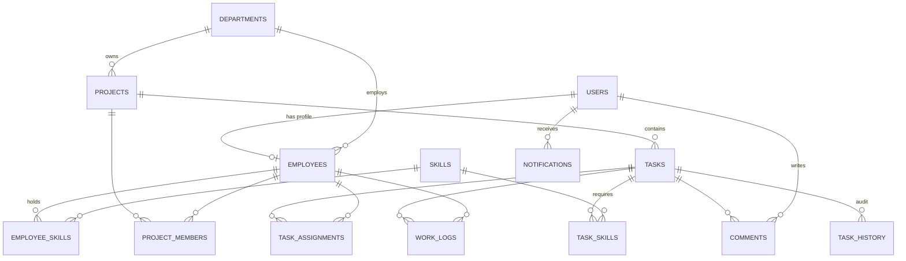

# Database

SQLite (via `sql.js`, WebAssembly). File: `backend/data/<DB_FILE>` (default `smart_workflow.db`). `DB_FILE=:memory:` gives an ephemeral database; the test suite uses this.

## Entity relationships

## Tables

| Table | Purpose | Notable columns / constraints |
| --- | --- | --- |
| `users` | Login identity | `email` UNIQUE; `role` ∈ SUPER_ADMIN/ADMIN/EMPLOYEE; `approval_status` ∈ PENDING/APPROVED/REJECTED; `is_active` |
| `employees` | Profile (1:1 with user) | `employee_code` UNIQUE (`EMP###`); `daily_capacity_hours` 0 to 24; `department_id` SET NULL on delete |
| `departments` | Org units | `name` UNIQUE, `is_active` |
| `skills` | Catalogue | `name` UNIQUE, `category` |
| `employee_skills` | Employee ↔ skill | PK(employee, skill); `numeric_score` **generated** from level (25/50/75/100) |
| `projects` | Group tasks | `requires_membership` restricts allocation to members; `is_archived` soft delete |
| `project_members` | Project ↔ employee | PK(project, employee) |
| `tasks` | Work items | `priority`, `status` (CHECK), `estimated_hours > 0`, `deadline` (UTC), `completed_at` |
| `task_skills` | Requirements | PK(task, skill); generated `min_numeric_score` |
| `task_assignments` | Assignment history | `is_current`; **partial unique index**: at most one current assignment per task |
| `work_logs` | Time tracking | `hours_worked` 0 to 24; `work_date` `YYYY-MM-DD` |
| `comments` | Discussion | |
| `task_history` | Audit trail | `action`, `details`, `actor_id` |
| `notifications` | In-app inbox | `type`, `is_read` |
| `attachments` | Files on tasks | `original_name` (display only), `stored_name` (random, UNIQUE), `mime_type`, `size_bytes`; cascades with the task |

All foreign keys are enforced (`PRAGMA foreign_keys = ON`). Deleting a task cascades to its skills, assignments, logs, comments and history.

## Migrations

`backend/src/config/schema.js` holds an ordered list; `PRAGMA user_version` records how many have run. On startup every pending migration runs in its own transaction.

| Version | Change |
| --- | --- |
| 1 | Base schema (idempotent `CREATE … IF NOT EXISTS`, so pre-versioning databases adopt it) |
| 2 | `tasks.completed_at`; one-current-assignment unique index; extra indexes; replaces the broken legacy seed password hash with a real bcrypt hash of `password123` |
| 3 | `users.avatar_file`; `attachments` table + index (file uploads) |
| 4 | `users.password_changed_at` (session revocation); `email_settings` (single row, id = 1), `email_outbox` (+ status/next-attempt index), `password_resets` (SHA-256 token hashes) |

**Adding a change:** append a new function to `migrations`, never edit a released one. `GET /api/health` reports `schemaVersion`.

**Backups:** before applying pending migrations to a database *file*, the server copies it to `backend/data/backups/<name>.v<old>.<timestamp>.db` (git-ignored). To roll back, stop the server and copy the backup over `smart_workflow.db`.

| Command | What it does |
| --- | --- |
| `npm run db:status` | Read-only: the file's schema version vs. the code's, pending migrations, backup count |
| `npm run db:migrate` | Backs up, applies pending migrations, prints row counts per table (safe to repeat) |
| `npm run db:reset` | Wipes and reseeds demo data |

**Uploaded files** live in `backend/uploads/{attachments,avatars}/` (git-ignored), named with 32 random hex characters plus the extension. Deleting an attachment or a task, or replacing a photo, removes the file from disk; failed uploads are cleaned up automatically.

## E-mail tables

| Table | Purpose |
| --- | --- |
| `email_settings` | The one global configuration (CHECK `id = 1`): enabled, transport `SMTP`/`LOG`, host/port/TLS/user, `smtp_password_enc` (AES-256-GCM, key from `SETTINGS_SECRET` or `JWT_SECRET`), sender, `app_url`, `disabled_events` (JSON array) |
| `email_outbox` | Transactional outbox. Rows are inserted in the same transaction as the notification that caused them, so rolled-back changes never send mail. `status` PENDING → SENT, or PENDING (retry after 1 min, then 4 min) → FAILED after 3 attempts |
| `password_resets` | One-time reset tokens: only `token_hash` (SHA-256) is stored, with `expires_at` and `used_at` |

## Persistence model

sql.js keeps the DB in memory. After each committed write the whole DB is exported and written to `<file>.tmp`, then renamed over the real file (atomic on the same volume). All access goes through a single promise queue, so transactions never interleave. This is fine for a university/demo-scale workload; for heavy concurrent production use, swap the driver for a native SQLite or PostgreSQL client behind the same repository interface.

## Seed data

Created automatically when the `users` table is empty, or on demand with `npm run db:reset`. Every account's password is `password123`.

| Email | Role | Notes |
| --- | --- | --- |
| superadmin@smartworkflow.org | Super Admin | |
| admin@smartworkflow.org | Admin | |
| john.doe@ | Employee | Backend: JS/Node expert |
| jane.smith@ | Employee | Designer |
| alex.jones@ | Employee | Flutter/Dart |
| rahim.uddin@ | Employee | QA |
| nusrat.jahan@ | Employee | Full-stack |
| tanvir.ahmed@ | Employee | Product analyst |
| sarah.khan@ | Employee | **Pending approval** |

Plus 4 departments, 11 skills, 3 projects (one members-only), and 15 tasks covering every status: one overdue, one that nobody is qualified for, and six completed over the last two weeks (one late) with time logs, comments and timestamped history, so dashboards, trends and reports have realistic data.
