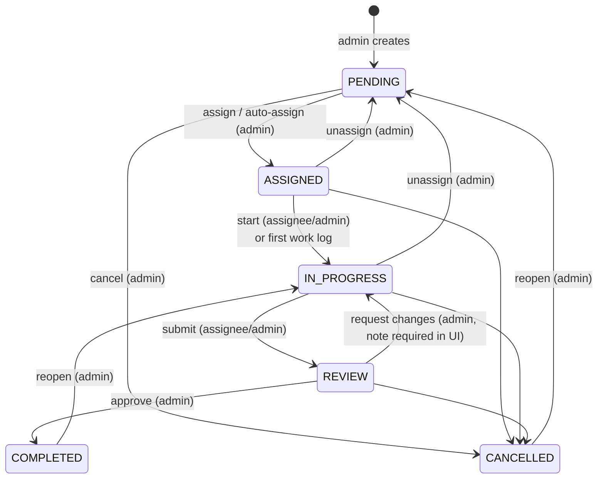

# Task Workflow

Source: `TRANSITIONS` in [`backend/src/services/taskService.js`](../../backend/src/services/taskService.js).

`GET /api/tasks/:id` returns `allowedTransitions` for the current user, and the UI renders exactly those buttons.

## Rules

| Action | Who | Conditions |
| --- | --- | --- |
| Create / edit | Admin | Project exists and isn't archived; deadline in the future; skills exist. Closed tasks are read-only. |
| Delete | Admin | Only `PENDING` or `CANCELLED` (cancel first otherwise). |
| Assign | Admin | Task open and unassigned; employee active, approved, `EMPLOYEE` role, eligible (or `force`). |
| Reassign | Admin | Currently assigned to someone else; keeps status; reason stored on the closed assignment. |
| Unassign | Admin | Returns task to `PENDING`. |
| Cancel | Admin | Ends the current assignment. |
| Log work | Current assignee | Task `ASSIGNED`/`IN_PROGRESS`; date not in future; ≤ 24 h per person per day. First log moves `ASSIGNED → IN_PROGRESS`. |
| Comment | Admins, current or past assignees | 1 to 2000 chars. |
| Attach files | Admin, current assignee | ≤ 5 files per upload; not on cancelled tasks. The uploader or an admin may delete (uploader not after completion). |
| View | Admins; employees who are or were assigned | Past assignees keep read-only access. |

Every action writes a `task_history` row (`CREATED, ASSIGNED, AUTO_ASSIGNED, REASSIGNED, UNASSIGNED, STATUS_CHANGED, WORK_LOGGED, WORK_LOG_DELETED, UPDATED, ATTACHMENT_ADDED, ATTACHMENT_REMOVED`).

## Notifications

Every notification is also e-mailed when the super admin has enabled e-mail and not switched that event off (see [DATABASE.md](DATABASE.md#e-mail-tables)).

| Event | Recipient |
| --- | --- |
| New self-registration | All admins |
| Account approved | The user |
| Task assigned / reassigned to you | New assignee |
| Task taken away (reassign/unassign) | Previous assignee |
| Employee starts work | All admins |
| Submitted for review | All admins |
| Approved / changes requested / cancelled / edited | Assignee |
| Comment | Admin comment → assignee; employee comment → admins |
