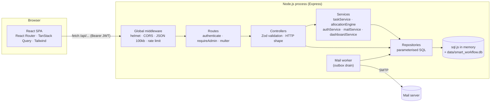
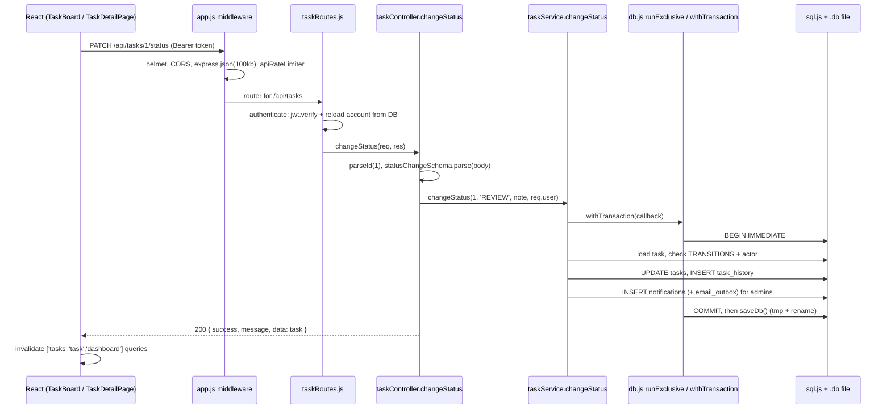

# 02 · Architecture

How the code is organised, how one request travels through it, and which design patterns are used.
Related reading: [ARCHITECTURE.md](../ai/ARCHITECTURE.md).

---

## The big picture



---

### Q: Describe your system architecture in one minute.
**[Basic]** It is a **client–server web application**:
- The **frontend** is a React Single-Page Application (SPA). It talks to the backend only through a JSON REST API.
- The **backend** is an Express application with a **layered architecture**: routes → controllers → services → repositories → database.
- The **database** is SQLite, run in memory by sql.js and saved to one file after every write.
- A small **background mail worker** sends e-mails from an outbox table.
In development, Vite serves React on port 5173 and proxies `/api` to Express on 5000. In production, Express serves the built React files itself ([app.js](../../backend/src/app.js) lines 75–79), so it is one process on one port.

### Q: What are the layers and what is the job of each?
**[Basic]**

| Layer | Folder | Job | Must NOT |
| --- | --- | --- | --- |
| Routes | [routes/](../../backend/src/routes) | Map URL + method to a controller; attach `authenticate`, `requireAdmin`, upload middleware | Contain business logic |
| Controllers | [controllers/](../../backend/src/controllers) | Parse `req`, validate with Zod, call services, send JSON | Write SQL |
| Services | [services/](../../backend/src/services) | Business rules: state machine, eligibility, scoring, transactions, notifications | Know about `req`/`res` |
| Repositories | [repositories/](../../backend/src/repositories) | All SQL for a group of tables, always parameterised | Check permissions |
| Config | [config/](../../backend/src/config) | env, DB connection + queue, migrations, seed | |
| Utils | [utils/](../../backend/src/utils) | Errors, async wrapper, dates, e-mail templates, encryption | |

### Q: Why use layers at all? Isn't it extra code?
**[Intermediate]** Layers give **separation of concerns**:
- You can test business rules without HTTP details, and change SQL without touching rules.
- The allocation engine is reused by four features (recommendations, assign, reassign, auto-assign) because it does not depend on `req`.
- If we move from SQLite to PostgreSQL, only `config/db.js` and some SQL in repositories change; services and controllers stay the same.
- New team members know where to look: "Where is the SQL for tasks?" → `taskRepository.js`.

Simple CRUD controllers (skills, departments) call repositories directly, because a service would only pass data through. That is a deliberate, pragmatic choice.

### Q: Trace one real request through the code: an employee submits a task for review.
**[Intermediate]** `PATCH /api/tasks/1/status` with body `{ "status": "REVIEW" }`:



Files: [app.js](../../backend/src/app.js) → [taskRoutes.js](../../backend/src/routes/taskRoutes.js) line 21 → [authMiddleware.js](../../backend/src/middleware/authMiddleware.js) lines 22–62 → [taskController.js](../../backend/src/controllers/taskController.js) lines 46–51 → [taskService.js](../../backend/src/services/taskService.js) lines 169–214 → [db.js](../../backend/src/config/db.js) lines 153–174.

### Q: What happens when something goes wrong inside that request?
**[Intermediate]**
- Services throw an `AppError` with a status code (`badRequest`, `forbidden`, `conflict`… in [errors.js](../../backend/src/utils/errors.js)).
- `withTransaction` catches it, runs `ROLLBACK`, and re-throws.
- [asyncHandler.js](../../backend/src/utils/asyncHandler.js) passes the rejected promise to `next(err)`.
- The global [errorHandler.js](../../backend/src/middleware/errorHandler.js) turns it into `{ success: false, message, errors }`. Zod errors → 400, Multer errors → 400/413, SQLite `UNIQUE` → 409, `FOREIGN KEY`/`CHECK` → 400, unknown → 500 with a generic message (details only in the server log).
- It also deletes any uploaded files from that failed request (line 23).

### Q: What design patterns did you use? Give a concrete example of each.
**[Intermediate]**

| Pattern | Where | What it gives us |
| --- | --- | --- |
| **Layered architecture** | routes/controllers/services/repositories | Separation of concerns |
| **Repository** | `*Repository.js` with optional executor `ex` | SQL in one place; same function works inside or outside a transaction |
| **Singleton** (shared resource) | one `db` connection exported from [db.js](../../backend/src/config/db.js) | Exactly one in-memory database per process |
| **Unit of Work / Transaction script** | `withTransaction(async (tx) => …)` | Multi-step changes are all-or-nothing |
| **Producer–consumer queue** | `runExclusive` promise chain | Statements never interleave |
| **State machine** | `TRANSITIONS` in [taskService.js](../../backend/src/services/taskService.js) | Only legal status changes, with role per transition |
| **Middleware chain (Chain of Responsibility)** | Express `authenticate → requireAdmin → controller → errorHandler` | Cross-cutting concerns reused on every route |
| **Transactional outbox** | `email_outbox` table + mail worker | E-mail only for committed changes; no network I/O inside a request |
| **Observer (publish/subscribe)** | `onEnqueue` listeners in [emailRepository.js](../../backend/src/repositories/emailRepository.js) | Worker wakes up immediately when mail is queued, without a hard dependency |
| **Strategy** | `createTransport` picks LOG or SMTP transport in [mailService.js](../../backend/src/services/mailService.js) | Same delivery code, different transport |
| **Factory** | `makeUploader(kind, allowed, maxBytes, maxFiles)` in [upload.js](../../backend/src/middleware/upload.js) | Two configured uploaders from one function |
| **DTO / mapping** | `toSessionUser`, `toDto` in controllers | Never leak password hashes or stored file names |

### Q: Explain the "optional executor" (`ex`) idea in the repositories.
**[Intermediate]** Every repository function has a last parameter `ex = defaultExecutor`:
```js
// backend/src/repositories/userRepository.js, line 37
export const updatePassword = (userId, passwordHash, ex = defaultExecutor) =>
  ex.query(`UPDATE users SET password_hash = ?, password_changed_at = DATETIME('now') ... WHERE id = ?`, [passwordHash, userId]);
```
- Called normally, it uses `defaultExecutor` (`{ query, queryOne }`), and each call is its own queued statement.
- Called with `tx` from `withTransaction`, it runs **inside** the open transaction.
So the same function is reused in both cases, and a service can combine many repository calls into one atomic operation. This is a simple form of **dependency injection**.

### Q: Why must code inside `withTransaction` always use `tx` and never the global `query`?
**[Hard]** `withTransaction` holds the exclusive queue for the whole callback. The global `query()` also waits for the queue. If the callback called `query()`, it would wait for the transaction to finish, and the transaction would wait for `query()` → **deadlock** (the request hangs). Also, the statement would not be part of the transaction. That is why services pass `tx` to every repository call.

### Q: Why is the app a SPA with a REST API, and not server-rendered pages?
**[Intermediate]**
- Rich interactions (drag-and-drop Kanban, live filters, modals, progress bars) are natural in React.
- A clean JSON API can be reused by a future mobile app or other systems.
- After the first load, only JSON travels over the network, so navigation is fast.
- The API is stateless (JWT), which keeps the backend simple.
Trade-off: SEO does not matter here (it is an internal tool behind login), so SPA disadvantages are small.

### Q: Why a monolith and not microservices?
**[Intermediate]**
- One small team, one domain, one database → microservices would add network calls, distributed transactions, deployment complexity and monitoring cost with no benefit.
- The allocation, assignment, history and notification must change **atomically**. In one process this is one SQL transaction. With microservices it would need sagas.
- The code is still **modular** (clear layers and folders), so parts like the mail worker could be extracted later if needed. This is called a *modular monolith*.

### Q: What does the response format look like, and why is it consistent?
**[Basic]**
```json
{ "success": true, "message": "optional", "data": { } }
{ "success": false, "message": "Human readable", "errors": [{ "field": "deadline", "message": "..." }] }
```
The frontend client ([api.js](../../frontend/src/lib/api.js)) relies on this: it throws an `ApiError` with `message` and `details` whenever `success` is false, so every page shows errors the same way.

### Q: Which HTTP status codes do you use and when?
**[Basic]** `200` OK · `201` created · `400` validation or business rule broken · `401` no/invalid/expired token · `403` logged in but not allowed · `404` not found · `409` conflict (duplicate, wrong state, already assigned) · `413` file too large · `429` rate limit · `503` password reset by e-mail not available · `500` unexpected error.

### Q: How is the backend started and stopped safely?
**[Intermediate]** [server.js](../../backend/src/server.js):
- `app.listen(PORT)`; if the port is busy, it prints a clear message and exits (lines 15–22).
- After listening, it starts the mail worker if `EMAIL_WORKER` is on (line 12).
- On `SIGINT`/`SIGTERM` it stops the worker, calls `saveDb()` one more time, closes the server, and force-exits after 3 seconds (lines 24–30).

### Q: Where is configuration kept?
**[Basic]** In environment variables loaded from `backend/.env` by [env.js](../../backend/src/config/env.js): `PORT`, `NODE_ENV`, `DB_FILE`, `JWT_SECRET`, `JWT_EXPIRES_IN`, `BCRYPT_ROUNDS`, `UPLOAD_DIR`, `MAX_UPLOAD_MB`, `SETTINGS_SECRET`, `EMAIL_WORKER`, `PASSWORD_RESET_TTL_MINUTES`, `ALLOWED_ORIGINS`. Each has a safe default for development. In production, a missing or short `JWT_SECRET` stops the server (lines 12–15). E-mail settings are the exception: they are stored in the database (see [07-email-system.md](07-email-system.md)).

### Q: How does the frontend know which API URL to call?
**[Basic]** [api.js](../../frontend/src/lib/api.js) uses `import.meta.env.VITE_API_BASE_URL || '/api'`. In development `/api` is proxied by Vite ([vite.config.js](../../frontend/vite.config.js)) to `http://localhost:5000`, so there is no CORS problem. In production the same origin serves both, so `/api` works too.

### Q: Is the backend stateless?
**[Intermediate]** The **HTTP layer** is stateless: no server sessions; every request carries a JWT. But the **process** holds state: the in-memory database, the exclusive queue, and the mail worker timer. That is why you can't just run two copies of the server on the same `.db` file (see [10-hard-and-cross-questions.md](10-hard-and-cross-questions.md)).

### Q: How would you add a new feature, for example "task tags"?
**[Intermediate]**
1. Add migration 5 in [schema.js](../../backend/src/config/schema.js) (`tags`, `task_tags` tables). Never edit old migrations.
2. Add `tagRepository.js` with parameterised SQL and the `ex` parameter.
3. Add Zod schemas in [schemas.js](../../backend/src/validators/schemas.js).
4. Add controller + routes with `authenticate`/`requireAdmin`.
5. Add integration tests in `backend/tests/`.
6. Frontend: add calls to [endpoints.js](../../frontend/src/lib/endpoints.js), a page or component, and invalidate the right query keys after mutations.

### Q: What are the main modules of the backend by feature?
**[Basic]** Auth & accounts (authService, adminController), Organisation (departments, skills, employees, projects), Tasks (taskService, allocationEngine, work logs, comments, attachments), Insight (dashboardService, reportRepository), Communication (notifications, emailRepository, mailService, emailTemplates).

### Q: Why Express 4 and not NestJS or Fastify?
**[Intermediate]** Express is the most widely known Node framework; it is small and easy to explain in a viva. NestJS adds decorators, modules and dependency injection, which is powerful but heavy for this size. Fastify is faster, but at our scale the bottleneck is the database, not the HTTP framework.

### Q: Why ES modules (`import`) on the backend?
**[Basic]** `"type": "module"` in [package.json](../../backend/package.json). It is the modern JavaScript standard, the same syntax as the frontend, and it allows **top-level `await`**, which [db.js](../../backend/src/config/db.js) line 23 uses to load the sql.js WebAssembly module before anything else runs.
