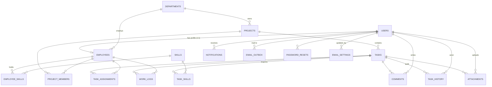

# 03 · Database

Schema, relations, normalisation, constraints, migrations, transactions — and exactly how the `.db` file is used by the code.
Related reading: [schema.js](../../backend/src/config/schema.js), [db.js](../../backend/src/config/db.js), [DATABASE.md](../ai/DATABASE.md).

---

## Entity–relationship diagram (schema v4)



## Tables (18)

| Table | Purpose | Key constraints |
| --- | --- | --- |
| `users` | Login identity | `email` UNIQUE; CHECK `role` ∈ SUPER_ADMIN/ADMIN/EMPLOYEE; CHECK `approval_status` ∈ PENDING/APPROVED/REJECTED; `password_changed_at` (v4); `avatar_file` (v3) |
| `employees` | Profile, 1:1 with user | `user_id` UNIQUE + FK CASCADE; `employee_code` UNIQUE; CHECK `0 < daily_capacity_hours <= 24`; `department_id` FK SET NULL |
| `departments` | Org units | `name` UNIQUE |
| `skills` | Skill catalogue | `name` UNIQUE |
| `employee_skills` | Employee ↔ skill (M:N) | PK(employee_id, skill_id); CHECK level; **generated** `numeric_score` |
| `projects` | Groups tasks | `requires_membership`, `is_archived` |
| `project_members` | Project ↔ employee (M:N) | PK(project_id, employee_id) |
| `tasks` | Work items | CHECK priority, CHECK status, CHECK `estimated_hours > 0`; `completed_at` (v2) |
| `task_skills` | Task ↔ required skill (M:N) | PK(task_id, skill_id); generated `min_numeric_score` |
| `task_assignments` | Assignment history | `is_current`; **partial UNIQUE index** (one current per task) |
| `work_logs` | Time tracking | CHECK `0 < hours_worked <= 24` |
| `task_history` | Audit trail | `action`, `details`, `actor_id` |
| `comments` | Discussion | FK to task and user |
| `notifications` | In-app inbox | `is_read` |
| `attachments` (v3) | Files on tasks | `stored_name` UNIQUE; CHECK `size_bytes > 0` |
| `email_settings` (v4) | Global SMTP config | `id` CHECK `(id = 1)` → single row; CHECK transport; CHECK port 1–65535 |
| `email_outbox` (v4) | Transactional outbox | CHECK status ∈ PENDING/SENT/FAILED; index (status, next_attempt_at) |
| `password_resets` (v4) | One-time reset tokens | `token_hash` UNIQUE; `expires_at`, `used_at` |

---

## Schema and relations

### Q: Why are `users` and `employees` separate tables?
**[Intermediate]** They hold different concerns. `users` = **authentication and authorisation** (email, password hash, role, approval, active). `employees` = **HR profile** (code, name, department, position, capacity). It is a 1:1 relation enforced by `user_id INTEGER NOT NULL UNIQUE` with `ON DELETE CASCADE` ([schema.js](../../backend/src/config/schema.js) lines 49–64). Benefits: the auth query in `authenticate` reads a small table; password hashes are never selected together with profile data by accident (`findUserById` uses a `PUBLIC_COLUMNS` list without the hash, [userRepository.js](../../backend/src/repositories/userRepository.js)).

### Q: Why do admins also have an `employees` row?
**[Basic]** So every account has a name, code and department to show in the UI and in history ("System Administrator (EMP001)"). Admins are **excluded from allocation** by the filter `u.role = 'EMPLOYEE'` in [allocationEngine.js](../../backend/src/services/allocationEngine.js) line 48.

### Q: How do you model many-to-many relationships?
**[Basic]** With junction tables that have a **composite primary key**: `employee_skills (employee_id, skill_id)`, `task_skills (task_id, skill_id)`, `project_members (project_id, employee_id)`. The composite PK prevents duplicates (an employee cannot have "SQL" twice), and the extra column stores the relationship data (proficiency level, minimum level, joined date).

### Q: Why is `task_assignments` a separate table instead of an `assigned_to` column on `tasks`?
**[Intermediate]** Because we want the **full history** of who worked on a task. Reassigning closes the old row (`is_current = 0`, `unassigned_at`, `reassignment_reason`) and inserts a new one. This gives:
- An audit trail of reassignments with reasons.
- Past assignees keep read-only access (`wasEverAssigned` in [taskRepository.js](../../backend/src/repositories/taskRepository.js)).
The current assignee is found with `LEFT JOIN task_assignments ta ON ta.task_id = t.id AND ta.is_current = 1`.

### Q: What is a "generated column" and where do you use it?
**[Intermediate]** A column whose value is calculated by the database from other columns. In `employee_skills` and `task_skills`:
```sql
-- backend/src/config/schema.js, line 78
numeric_score INTEGER GENERATED ALWAYS AS (CASE proficiency_level WHEN 'BEGINNER' THEN 25 ... WHEN 'EXPERT' THEN 100 END) STORED
```
The application only writes the level text; the database keeps the number in sync automatically, so the two can **never disagree**. The allocation engine compares numbers (`score < req.min_numeric_score`).

### Q: Which values are calculated and not stored?
**[Intermediate]** `logged_hours`, `remaining_hours`, `is_overdue`, `comment_count`, `active_task_count`, `outstanding_hours`, workload percentages. They are computed in SQL at read time (for example `REMAINING_HOURS_SQL` in [employeeRepository.js](../../backend/src/repositories/employeeRepository.js) lines 4–5: `MAX(0, estimated_hours − SUM(hours_worked))`). Storing them would risk stale data whenever a work log is added or deleted.

---

## Normalisation

### Q: Which normal form is your database in?
**[Intermediate]** Mostly **Third Normal Form (3NF)**:
- **1NF**: every column is atomic (no lists in a column, except `email_settings.disabled_events`, see below); every table has a primary key.
- **2NF**: in tables with composite keys (`employee_skills`, `task_skills`, `project_members`), the non-key columns depend on the **whole** key (the level depends on the pair employee+skill, not on one of them).
- **3NF**: no non-key column depends on another non-key column. For example, the department name is not copied into `employees`; we store `department_id` and join.

### Q: Are there any places where you deliberately break normalisation?
**[Hard]** Yes, and each one has a reason:
- `numeric_score` depends on `proficiency_level` (a transitive dependency). It is a **generated** column, so there is no update anomaly.
- `email_settings.disabled_events` is a JSON array in a TEXT column. It is a small config list read as a whole; a separate table would add joins for no benefit.
- `notifications.title/message`, `task_history.details`, `email_outbox.to_email/subject/html_body` are **snapshots**. History must show what was true *at that time*; if a user later changes their name or e-mail, old history and already-sent mail must not change.
- `employees.category` is free text that can overlap with the department. It is a label, not a relation.

### Q: Give an example of an anomaly your design avoids.
**[Basic]** Update anomaly: if every task row stored the assignee's name, renaming the employee would require updating many rows, and missing one gives inconsistent data. We store only `employee_id` in `task_assignments` and join to `employees` to get the current name.

---

## Constraints and indexes

### Q: What kinds of constraints do you use?
**[Basic]**
- `PRIMARY KEY` (single or composite), `NOT NULL`, `DEFAULT (DATETIME('now'))`.
- `UNIQUE`: `users.email`, `employees.user_id`, `employees.employee_code`, `skills.name`, `departments.name`, `attachments.stored_name`, `password_resets.token_hash`.
- `CHECK`: enum-like values (role, status, priority, proficiency), ranges (`daily_capacity_hours` 0–24, `hours_worked` 0–24, `estimated_hours > 0`, `smtp_port` 1–65535, `size_bytes > 0`), and `email_settings.id = 1`.
- `FOREIGN KEY` with `ON DELETE CASCADE` or `SET NULL`.
- A **partial UNIQUE index** for "one current assignment".
The application validates first with Zod; the constraints are the **last line of defence** if a bug or a manual SQL edit tries to write bad data.

### Q: Explain the partial unique index `uq_assignments_one_current`.
**[Hard]**
```sql
-- backend/src/config/schema.js, lines 213-214
CREATE UNIQUE INDEX IF NOT EXISTS uq_assignments_one_current
  ON task_assignments(task_id) WHERE is_current = 1;
```
The uniqueness applies **only to rows where `is_current = 1`**. So a task may have many old (closed) assignment rows, but **at most one current** one. A normal `UNIQUE(task_id)` would forbid history; `UNIQUE(task_id, is_current)` would forbid two closed rows. Even if a bug in the service tried to insert a second current assignment, SQLite would reject it with `UNIQUE constraint failed`, which [errorHandler.js](../../backend/src/middleware/errorHandler.js) maps to HTTP 409.

### Q: Which `ON DELETE` rules did you choose and why?
**[Intermediate]**
- `CASCADE` for things that cannot exist without the parent: deleting a task deletes its skills, assignments, work logs, comments, history and attachment rows; deleting a user deletes their employee profile, notifications and reset tokens.
- `SET NULL` for optional links: deleting a department leaves employees and projects without a department; `approved_by`, `email_settings.updated_by` and `email_outbox.user_id` become NULL.
- **No action** (default restrict) for `tasks.created_by`, `task_assignments.assigned_by`, `task_history.actor_id`: you cannot delete a user who created tasks, which protects the audit trail.
In practice the app **deactivates** users instead of deleting them.

### Q: How do you make sure SQLite actually enforces foreign keys?
**[Hard]** SQLite has foreign keys **off by default**, per connection. [db.js](../../backend/src/config/db.js) runs `PRAGMA foreign_keys = ON;` at startup (line 65) **and before every statement and transaction** (lines 138 and 155), because the comment on line 64 notes that `db.export()` (used when saving) resets connection pragmas in sql.js.

### Q: Which indexes do you have and why?
**[Intermediate]**

| Index | Used by |
| --- | --- |
| `idx_users_role_status (role, approval_status)` | user lists filtered by role/status, `listAdminUserIds`, `countActiveSuperAdmins` |
| `idx_employees_dept_cat` | employee filters, department reports |
| `idx_tasks_project`, `idx_tasks_status_deadline` | task lists by project, overdue queries (`status NOT IN … AND deadline < now`) |
| `idx_assignments_task_current`, `idx_assignments_emp_current` | "current assignee of task" and "active tasks of employee" (workload) |
| `uq_assignments_one_current` (partial unique) | integrity + fast lookup of the current row |
| `idx_work_logs_emp_date` | the 24 h/day check (`SUM(hours) WHERE employee_id = ? AND work_date = ?`) |
| `idx_work_logs_task` | `logged_hours` / `remaining_hours` subqueries |
| `idx_comments_task`, `idx_history_task`, `idx_attachments_task` | task detail tabs |
| `idx_notifications_user_read` | unread count in the bell |
| `idx_outbox_status_next (status, next_attempt_at)` | the mail worker's `listDue` query |
| `idx_password_resets_user` | invalidating older tokens of a user |

Honest note: `idx_users_email` is **redundant**, because `email UNIQUE` already creates an automatic index. It does no harm except a little extra write cost.

### Q: Do indexes have a cost?
**[Basic]** Yes. Every INSERT/UPDATE/DELETE must also update each index, and indexes use space. We only index columns used in `WHERE`, `JOIN` or `ORDER BY` of frequent queries.

### Q: How are dates stored?
**[Intermediate]** As TEXT in SQLite's canonical UTC format `YYYY-MM-DD HH:MM:SS` (same as `DATETIME('now')`). [dates.js](../../backend/src/utils/dates.js) converts all input to this format, so **string comparison equals time comparison** (`deadline < DATETIME('now')`). The original code stored ISO strings like `2025-01-01T10:00:00Z`, which compared wrongly; this was audit defect #13.

---

## Migrations and backups

### Q: How do migrations work?
**[Intermediate]** [schema.js](../../backend/src/config/schema.js) has an ordered array `migrations` (4 functions). SQLite's `PRAGMA user_version` (an integer stored in the file header) records how many have run.
```js
// backend/src/config/schema.js, lines 310-323
export const runMigrations = (db) => {
  const current = db.exec('PRAGMA user_version')[0].values[0][0];
  for (let version = current + 1; version <= migrations.length; version++) {
    db.exec('BEGIN');
    try {
      migrations[version - 1](db);
      db.exec(`PRAGMA user_version = ${version}`);
      db.exec('COMMIT');
    } catch (err) {
      db.exec('ROLLBACK');
      throw new Error(`Database migration ${version} failed: ${err.message}`);
    }
  }
};
```
Each pending migration runs in **its own transaction** together with the version bump, so a failed migration leaves the DB at the previous version. `SCHEMA_VERSION = migrations.length` (line 308), currently **4**.

### Q: What does each migration do?
**[Basic]**

| v | Change |
| --- | --- |
| 1 | Base schema: 14 tables + 8 indexes (`CREATE … IF NOT EXISTS`, so old pre-versioning databases adopt it safely) |
| 2 | `tasks.completed_at`, one-current-assignment index, 4 more indexes, repair of the broken legacy seed password hash |
| 3 | `users.avatar_file`, `attachments` table + index |
| 4 | `users.password_changed_at`, `email_settings` (single row), `email_outbox`, `password_resets` |

### Q: Why must you never edit a released migration?
**[Intermediate]** Databases that already ran migration N have `user_version >= N` and will **never run it again**. If you change migration 3, old databases keep the old version and new databases get the new one, so they silently differ. The rule (comment on line 6 of `schema.js`): **append a new migration instead**.

### Q: Why do migrations use `IF NOT EXISTS` and check `PRAGMA table_info` before `ALTER TABLE`?
**[Hard]** To be **idempotent** for databases created before versioning existed (they have tables but `user_version = 0`). Migration 1 must not fail on existing tables, and migrations 2–4 check whether a column exists before `ALTER TABLE … ADD COLUMN`, because SQLite has no `ADD COLUMN IF NOT EXISTS`.

### Q: How are backups made before a migration?
**[Intermediate]** [db.js](../../backend/src/config/db.js) lines 53–61, `backupBeforeMigration(fromVersion)`: if the file exists, is not in-memory, and its version is between 1 and `SCHEMA_VERSION − 1`, it copies the file to `backend/data/backups/<name>.v<old>.<timestamp>.db` **before** running migrations. To roll back: stop the server and copy the backup over `smart_workflow.db`. The `backups/` folder is git-ignored.

---

## Transactions and ACID

### Q: How do you use transactions?
**[Intermediate]** `withTransaction(callback)` in [db.js](../../backend/src/config/db.js) lines 153–174:
```js
export const withTransaction = (callback) =>
  runExclusive(async () => {
    db.exec('PRAGMA foreign_keys = ON;');
    db.exec('BEGIN IMMEDIATE');
    const tx = { query: async (sql, params = []) => execute(sql, params), queryOne: ... };
    try {
      const result = await callback(tx);
      db.exec('COMMIT');
      saveDb();
      return result;
    } catch (error) {
      try { db.exec('ROLLBACK'); } catch { /* already closed */ }
      throw error;
    }
  });
```
Example: assigning a task closes the old assignment, inserts the new one, updates status, writes history, inserts notifications **and** outbox e-mails — all in one transaction ([taskService.js](../../backend/src/services/taskService.js) lines 218–252).

### Q: Explain ACID for your system.
**[Hard]**
- **Atomicity**: `BEGIN … COMMIT`, and any thrown error → `ROLLBACK`. A test proves that a rolled-back transaction leaves no outbox e-mail ([email.test.js](../../backend/tests/email.test.js) "never sends mail for a rolled-back transaction").
- **Consistency**: CHECK, UNIQUE, FK and the partial unique index, plus service rules (state machine, eligibility).
- **Isolation**: the strongest possible — **serial execution**. The exclusive queue lets only one statement or transaction run at a time, so there are no dirty reads, lost updates or phantoms.
- **Durability**: after COMMIT, `saveDb()` writes the whole database to disk atomically. This is weaker than native SQLite: there is no `fsync`, and if writing fails (for example disk full) the error is only logged (line 43) while the API still answers success. Honest limitation.

### Q: Is the read-then-write check inside services safe from race conditions?
**[Hard]** Inside `withTransaction`, yes: e.g. `assignTask` reads "is the task already assigned?" and then inserts, with no other request able to run in between (queue). **Outside** a transaction it is not guaranteed. Example we found and fixed: `changeRole` and `setActive` in [adminController.js](../../backend/src/controllers/adminController.js) used to count active super admins **before** the write, outside the transaction, so two super admins demoting each other at the same moment could both pass the check. The count now runs inside the same `withTransaction` as the update.

---

## How the `.db` file is used directly in code

This section walks through [db.js](../../backend/src/config/db.js) line by line.

### Q: How is `backend/data/smart_workflow.db` opened?
**[Intermediate]**
```js
// db.js lines 19-32
const inMemory = env.DB_FILE === ':memory:';
const dbDir = path.resolve(__dirname, '../../data');
const dbPath = inMemory ? null : path.resolve(dbDir, env.DB_FILE);

const SQL = await initSqlJs();                       // load SQLite compiled to WebAssembly

const openDatabase = () => {
  if (dbPath && fs.existsSync(dbPath)) {
    return new SQL.Database(fs.readFileSync(dbPath)); // read the WHOLE file into memory
  }
  return new SQL.Database();                          // new empty database
};

export let db = openDatabase();
```
1. `env.DB_FILE` defaults to `smart_workflow.db` ([env.js](../../backend/src/config/env.js) line 21); the path is always inside `backend/data/`.
2. `initSqlJs()` loads the WebAssembly SQLite engine (top-level `await`).
3. `fs.readFileSync` reads the file's bytes; `new SQL.Database(bytes)` creates an **in-memory** database from them.
4. From now on **all reads and writes happen in RAM**. The file on disk is only a saved copy.

### Q: What happens right after opening?
**[Intermediate]** `initialise()` (lines 63–78) runs once at import time:
1. `PRAGMA foreign_keys = ON`.
2. Reads `PRAGMA user_version` (old version).
3. `backupBeforeMigration` copies the file if an upgrade is needed.
4. `runMigrations(db)` applies pending migrations.
5. If `users` is empty → `populateSeedData(db)` (demo data).
6. `saveDb()` writes the result to disk.

### Q: How is data read?
**[Intermediate]** `execute()` (lines 100–116) prepares a statement, binds parameters, and steps through rows:
```js
const stmt = db.prepare(sql);
stmt.bind(normaliseParams(params));     // undefined → null, true/false → 1/0
const columns = stmt.getColumnNames();
if (columns.length > 0) {               // SELECT-like: return row objects
  const rows = [];
  while (stmt.step()) rows.push(stmt.getAsObject());
  return rows;
}
stmt.step();                            // write: run once
...
const [{ values }] = db.exec('SELECT last_insert_rowid(), changes()');
return { insertId: ..., affectedRows: ... };
```
Reads never touch the disk; they read the in-memory database. `stmt.free()` in `finally` releases WebAssembly memory even on errors.

### Q: How is data written to the file?
**[Hard]** `query()` (lines 136–142) runs the statement and, **if it was a write**, calls `saveDb()`:
```js
// db.js lines 35-45
export const saveDb = () => {
  if (inMemory) return;
  try {
    if (!fs.existsSync(dbDir)) fs.mkdirSync(dbDir, { recursive: true });
    const tmp = `${dbPath}.tmp`;
    fs.writeFileSync(tmp, Buffer.from(db.export()));   // 1. serialise whole DB to bytes, write to .tmp
    fs.renameSync(tmp, dbPath);                         // 2. replace the real file in one step
  } catch (err) {
    console.error('Failed to save SQLite DB to disk:', err.message);
  }
};
```
- `db.export()` returns the complete database as a `Uint8Array` (SQLite file format).
- Writing to `.tmp` first and then `rename` is the **atomic write** pattern: a rename on the same disk is all-or-nothing, so the real file is always either the full old version or the full new version — **never half-written**.
- Inside a transaction, `saveDb()` runs only **once, after COMMIT** (line 164), not after each statement.

### Q: Why does every read and write go through the queue?
**[Hard]**
```js
// db.js lines 124-130
let tail = Promise.resolve();
const runExclusive = (fn) => {
  const run = tail.then(fn);     // start fn only after everything before it has finished
  tail = run.catch(() => {});    // the next caller waits for this one; errors don't break the chain
  return run;
};
```
There is **one** in-memory connection shared by all requests. A transaction callback is `async` and `await`s between statements. Without the queue, request B could run its statements in the middle of request A's transaction: B's writes would be rolled back if A failed, or B would get "cannot start a transaction within a transaction". This was audit defect #3. The queue makes every statement/transaction run **one after another** (FIFO), like a mutex with a waiting line.

### Q: What happens if the server crashes?
**[Hard]**
- **Crash between two requests**: nothing lost; every committed write was already saved.
- **Crash in the middle of a transaction**: the transaction never committed and `saveDb()` never ran, so the file holds the state *before* the transaction. That is correct (atomicity).
- **Crash after COMMIT but before/while `saveDb()` finishes**: that last write is lost (it was only in RAM), but the file is still the previous complete version, thanks to tmp + rename. A leftover `smart_workflow.db.tmp` may remain; it is ignored and overwritten next time (and git-ignored).
- **Power loss**: no `fsync` is called, so the OS might not have flushed the file yet. Native SQLite with WAL journaling is stronger here.

### Q: Why must you not edit the `.db` file while the server is running?
**[Intermediate]** The server read the file **once at startup** and works in memory. If you edit the file with DB Browser for SQLite:
1. The server never sees your change (it doesn't re-read the file).
2. On the **next write** from the app, `saveDb()` overwrites the file with the in-memory version, and **your edit disappears**.
Also, running **two servers** on the same file means each has its own memory copy and they overwrite each other's saves. Correct procedure: stop the server → edit or replace the file → start again. ([RUNBOOK.md](../ai/RUNBOOK.md) troubleshooting row says the same.)

### Q: How do `db:status`, `db:migrate` and `db:reset` work?
**[Intermediate]**

| Command | File | What it really does |
| --- | --- | --- |
| `npm run db:status` | [status.js](../../backend/src/config/status.js) | **Read-only.** Opens the file with its own sql.js instance (does not import `db.js`, so no migration/seed runs), prints `PRAGMA user_version` vs `SCHEMA_VERSION`, pending count and number of backups, then closes. |
| `npm run db:migrate` | [migrate.js](../../backend/src/config/migrate.js) | Imports `db.js`, which **opens, backs up, migrates, seeds if empty and saves** (that is the normal startup path). Then prints from→to version, backup path and row counts per table. Safe to repeat. |
| `npm run db:reset` (alias `seed`) | [seed.js](../../backend/src/config/seed.js) | Calls `resetDatabase()` (db.js lines 83–87): closes the DB, creates an **empty** one, runs `initialise()` (all migrations + demo data) and saves, which **replaces the file**. All your data is gone. |

Run them **while the server is stopped**; otherwise the running server will overwrite the file on its next write.

### Q: How do the tests avoid touching the real `.db` file?
**[Basic]** [setupEnv.js](../../backend/tests/setupEnv.js) sets `DB_FILE=':memory:'` before the app is imported. Then `inMemory = true`, `dbPath = null`, `saveDb()` returns immediately, and every Jest test file (Jest gives each file its own module registry) gets a fresh, seeded in-memory database.

### Q: Why sql.js and not the `sqlite3` or `better-sqlite3` npm package?
**[Intermediate]** Native packages need a C/C++ build or a matching prebuilt binary for the exact Node version and OS. On student and lab machines this often fails (the original project had the same problem with native `bcrypt`, audit defect #2). sql.js is pure WebAssembly: `npm install` always works on Windows, macOS and Linux. The trade-offs are the in-memory model, a full-file write per commit, and no multi-process access — acceptable at this scale, and isolated in `db.js`.

### Q: How large can the database grow before this becomes a problem?
**[Hard]** Each write exports and rewrites the **entire** file, so write cost is O(database size). With a few MB (thousands of tasks) it is milliseconds. At hundreds of MB, every click would rewrite hundreds of MB and memory use would equal the file size. Then you should switch to native SQLite (WAL mode, page-level writes) or PostgreSQL; only `db.js` and some SQL syntax would change.
