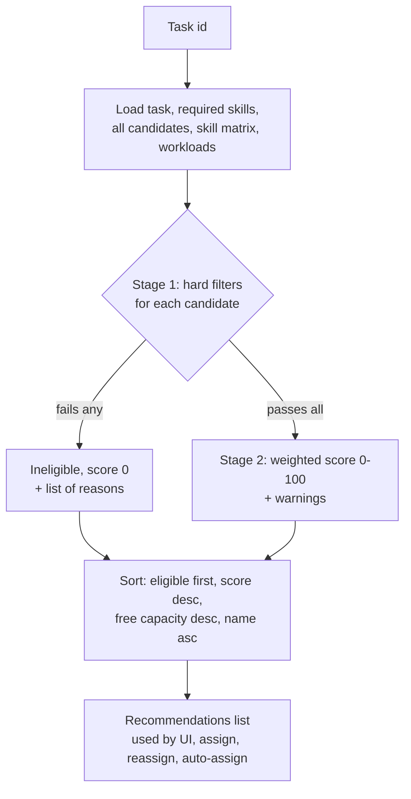

# 04 · Smart Allocation Algorithm

How the system chooses the best employee for a task.
Source: [allocationEngine.js](../../backend/src/services/allocationEngine.js). Related: [ALLOCATION_ENGINE.md](../ai/ALLOCATION_ENGINE.md).

---

## Overview



---

### Q: Explain your allocation algorithm in simple words.
**[Basic]** It works in two stages:
1. **Filter (yes/no).** Remove people who *cannot* do the task: wrong role, not approved/active, missing a required skill or below the minimum level, or not a project member when the project requires membership.
2. **Score (0–100).** For everyone left, compute a weighted score from four parts: skill depth (40%), free weekly capacity (25%), number of parallel tasks (20%), and whether they can finish before the deadline (15%). Highest score first.
The admin sees the ranking, the four sub-scores, warnings and the reasons for ineligibility, and can assign, or press **Auto-assign** to take the top one.

### Q: What exactly are the hard eligibility filters?
**[Basic]**
1. Candidate list SQL (lines 41–49): `u.approval_status = 'APPROVED' AND u.is_active = 1 AND e.is_active = 1 AND u.role = 'EMPLOYEE'`. Admins and pending users are never listed.
2. For **every** required skill: the employee must have it (`Lacks required skill: X`) with `numeric_score >= min_numeric_score` (`Insufficient proficiency in X (has 50, requires 75)`) — lines 90–99.
3. If `requires_membership = 1` on the project, the employee must be in `project_members` (lines 100–102).
Proficiency levels map to numbers: BEGINNER 25, INTERMEDIATE 50, ADVANCED 75, EXPERT 100 (generated column in the DB).

### Q: What is the scoring formula?
**[Basic]**
```
total = round( 0.40 × SkillMatch + 0.25 × WorkloadBalance + 0.20 × Availability + 0.15 × DeadlineFit )
```
`WEIGHTS` is defined (and frozen) on line 26.

| Component | Formula (code line) | Meaning |
| --- | --- | --- |
| **SkillMatch** | average over required skills of `75 + 25·(emp − req)/(100 − req)`; `100` if `req = 100`; `100` if no skills required (lines 36–39, 137–143) | Meeting the minimum = 75; more expertise → up to 100 |
| **WorkloadBalance** | `remainingCapacity / weeklyCapacity × 100` where `weeklyCapacity = dailyCapacity × 5`, `remainingCapacity = max(0, weekly − outstanding)` (line 145) | Share of the week still free |
| **Availability** | `max(0, 100 − 15 × activeTaskCount)` (line 146) | Penalty for many parallel tasks (context switching) |
| **DeadlineFit** | `min(100, hoursFreeBeforeDeadline / effort × 100)`; `0` if deadline passed (line 147) | Can they finish in time? |

Definitions:
- **outstanding** = sum of `max(0, estimated − logged)` over the person's current tasks in ASSIGNED/IN_PROGRESS/REVIEW, **excluding this task** (lines 52–65).
- **effort** = remaining hours of this task, at least 0.5 h (line 79).
- **workingDaysLeft** = calendar days left × 5/7 (lines 81–82).
- **hoursFreeBeforeDeadline** = `workingDaysLeft × dailyCapacity − (remaining hours of their tasks due on or before this deadline)` (line 111).

### Q: Show a worked example with your seed data.
**[Intermediate]** Task 4 **"REST API for Task Allocation"**: requires JavaScript ≥ ADVANCED (75) and Node.js ≥ ADVANCED (75), 20 h, deadline ≈ 10 days, project 1 (no membership rule).

**Stage 1:**
| Employee | JS | Node.js | Result |
| --- | --- | --- | --- |
| John Doe | EXPERT 100 | EXPERT 100 | eligible |
| Nusrat Jahan | ADVANCED 75 | ADVANCED 75 | eligible |
| Alex Jones | ADVANCED 75 | — | ineligible: lacks Node.js |
| Rahim Uddin | INTERMEDIATE 50 | — | ineligible: insufficient JS, lacks Node.js |
| Jane Smith, Tanvir Ahmed | — | — | ineligible: lacks both |
| Sarah Khan | — | — | not listed (PENDING) |

**Stage 2 — John Doe** (daily capacity 8 → weekly 40). His active task: task 1 (16 h estimate − 7.5 h logged = 8.5 h outstanding, 1 active task).
- SkillMatch: JS `75 + 25·(100−75)/(100−75) = 100`, Node `100` → **100**
- WorkloadBalance: `(40 − 8.5)/40 × 100 = 78.75`
- Availability: `100 − 15×1 = 85`
- DeadlineFit: working days ≈ `10 × 5/7 ≈ 7.1` → `7.1 × 8 ≈ 57 h`, minus 8.5 h due earlier ≈ 48.6 h free ≥ 20 h → **100** (capped)
- Total: `0.4×100 + 0.25×78.75 + 0.2×85 + 0.15×100 = 40 + 19.69 + 17 + 15 = 91.69` → **92**

**Nusrat Jahan** (weekly 40, no active tasks — her only task is completed):
- SkillMatch: `75 + 25·0/25 = 75` for both → **75**; Workload **100**; Availability **100**; DeadlineFit **100**
- Total: `30 + 25 + 20 + 15` = **90**

**Result:** John 92, Nusrat 90. John's deeper skill outweighs his existing load. If John had two more active tasks, his availability would drop to 55 (−6 points) and Nusrat would rank first. This matches the table in [ALLOCATION_ENGINE.md](../ai/ALLOCATION_ENGINE.md).

### Q: Why is meeting the minimum worth 75 and not 100?
**[Intermediate]** If meeting the minimum gave 100, every eligible person would get the same skill score and skill would stop distinguishing people (that was audit defect #11 in the original code). With 75 at the minimum and a linear rise to 100 at EXPERT, deeper expertise is rewarded, but the jump is limited (max +25 × 0.4 = 10 points), so an overloaded expert does not always win.

### Q: Why these weights (40/25/20/15)?
**[Intermediate]** They are a **reasoned heuristic**, not learned from data:
- **Skill (40%)** is the largest single factor because it most affects quality; but the minimum is already guaranteed by the filter, so 40% only rewards *extra* depth.
- **Workload (25%) + Availability (20%) = 45%** together, which is more than skill. This deliberately pushes work to less-loaded people and avoids burning out the best performer.
- **Deadline (15%)**: lowest, because an impossible deadline is also shown as a **warning**, and it often affects all candidates similarly.
The weights sum to 1, so the total stays on a 0–100 scale; a unit test checks this ([allocation.test.js](../../backend/tests/allocation.test.js) "weights sum to 1").

### Q: How can the weights be changed?
**[Basic]** Edit the constants at the top of [allocationEngine.js](../../backend/src/services/allocationEngine.js): `WEIGHTS` (line 26), `WORK_DAYS_PER_WEEK` (line 28), `AVAILABILITY_PENALTY_PER_TASK` (line 29). Keep the sum of weights equal to 1 (the test will fail otherwise). The API returns the weights in the response (`weights: WEIGHTS`). They are **not** editable from the UI; making them a super-admin setting (like e-mail settings) is possible future work.

### Q: How are ties broken?
**[Intermediate]** Sort comparator (lines 181–188):
1. Eligible before ineligible.
2. Higher `totalScore` first.
3. If equal: more `remainingCapacityHours` first (the person with more free hours).
4. If still equal: alphabetical by name (`localeCompare`) so the order is **deterministic** (same input → same output every time).

### Q: Is the alphabetical tie-break fair?
**[Hard]** Honestly, it is a small bias: when two people have the **same score and same free hours**, the name earlier in the alphabet wins. It only happens in exact ties, and after one of them gets the task, their workload changes, so the next tie goes the other way. A fairer final tie-break would be "least recently assigned" (from `task_assignments.assigned_at`) or a random choice. We chose determinism because it makes results reproducible and testable.

### Q: Prove (or argue) that the allocation is fair.
**[Hard]**
- **Same rules for everyone**: one formula, no manual exceptions; inputs are only skills, capacity, current tasks, deadlines and membership. Name, gender, age, department are **not** inputs (name only for an exact tie).
- **Self-balancing**: a person who gets a task gains outstanding hours and an active task, so their WorkloadBalance and Availability fall for the next task. Work spreads out over time. A test shows a less-loaded person beats a busier one with equal skills ("prefers less-loaded employees when skills are equal").
- **Respects personal capacity**: capacity is per person (`daily_capacity_hours`, e.g. Rahim 7 h, Tanvir 6 h), so part-time people are not overloaded.
- **Transparent**: every sub-score and reason is shown; the employee could check the numbers.
- **Accountable overrides**: an admin may force-assign an ineligible person, but history records `[override]`.
Limitation: it is fairness by **workload**, not by "who gets interesting tasks"; that would need extra data.

### Q: What warnings can the engine produce, and do they block assignment?
**[Basic]** Warnings do **not** block (lines 149–157):
- "Deadline has already passed"
- "Only Xh free before the deadline for Yh of work"
- "Assignment would exceed weekly capacity"
Only Stage-1 failures block, and even those can be overridden with `force: true`.

### Q: What is the time complexity?
**[Hard]** Let E = number of active employees, S = rows in `employee_skills`, R = required skills of the task, A = current active assignments.
- Loading: candidates O(E), skill matrix O(S), workloads O(A) plus the remaining-hours subqueries (indexed by `idx_work_logs_task`).
- Per candidate: O(R) skill checks with `Map` lookups (O(1) each) → O(E·R).
- Sorting: O(E log E).
- **Total ≈ O(S + A + E·R + E log E)**, effectively **O(E log E)** since R is small (max 20 by validation).
Memory is O(E + S). All four loads run with `Promise.all` but, because of the queue, they execute one after another.

### Q: What happens with 10,000 employees?
**[Hard]** The algorithm itself is fine: 10,000 × a few skills plus a sort is a few milliseconds in JavaScript. The real costs are:
- The SQL loads read all employee skills and all active assignments (tens of thousands of rows) — still fast in SQLite memory.
- The response JSON lists **all 10,000** candidates, which is big for the browser. Improvement: return only the top N eligible + a count of ineligible.
- In `assign`/`auto-assign`, the engine runs **inside the transaction**, which holds the global queue, so other requests wait during that time.
Improvements: pre-filter in SQL (join on required skills), paginate, cache the skill matrix.

### Q: Why does auto-assign run the engine inside the transaction?
**[Intermediate]** So the decision and the write happen on the **same snapshot**. Between "calculate best candidate" and "insert assignment", nobody else can change workloads or skills. If the engine ran first and the write later, another admin could assign another task to the same person in between, making the decision stale ([taskService.js](../../backend/src/services/taskService.js) lines 290–298).

### Q: Does manual assignment also check eligibility?
**[Intermediate]** Yes. `assignWithin` calls `assertAssignableEmployee` (exists, role EMPLOYEE, active, approved) and `assertEligible`, which runs the full engine and refuses an ineligible person unless `force` is true (lines 100–108, 218–252). Before the rebuild, assign accepted any id — even admins or non-existent employees (audit defect #7).

### Q: Why use remaining hours instead of estimated hours?
**[Intermediate]** If a 40-hour task is 90% done, the person is almost free. Using the estimate would keep them "full" until the task closes. With `remaining = max(0, estimate − logged)`, logging work **frees capacity** immediately. A test checks that John's workload is 8.5 h, not 16 h ("uses remaining (not estimated) hours").

### Q: Why multiply calendar days by 5/7?
**[Intermediate]** People do not work 7 days a week. A deadline 7 calendar days away gives about 5 working days. It is an approximation: it ignores the actual weekday, public holidays and leave. A calendar-aware version is future work.

### Q: Why not use the Hungarian algorithm?
**[Hard]** The Hungarian algorithm finds the **globally optimal one-to-one matching** between n tasks and n workers in O(n³). It does not fit our situation well:
- Tasks arrive **one at a time** (online problem); we assign each when it is created or needed.
- It is one-to-one, but one employee can take several tasks (capacity constraint), and it can't express "ineligible" easily without large penalty costs.
- Its result is harder to **explain** to the admin than "John: skill 100, workload 79…".
It would make sense for a future **"allocate all pending tasks at once"** feature, using our score as the cost matrix (cost = 100 − score).

### Q: Why not machine learning?
**[Hard]**
- **No training data**: a new system has no history of "good" assignments. ML needs many labelled examples.
- **Explainability**: managers must trust and justify decisions. A rule-based score is fully transparent; most ML models are not.
- **Bias risk**: ML can learn historical bias (e.g. always giving tasks to the same people).
- **Simplicity**: deterministic code is easy to test.
Future: once enough history exists (on-time completion, hours vs estimate), we could **tune the weights** from data (e.g. logistic regression) while keeping the same explainable formula.

### Q: Is this a greedy algorithm?
**[Intermediate]** Yes. For each task it picks the locally best candidate at that moment, without looking ahead to future tasks. Greedy is fast, simple and explainable, but not globally optimal: assigning John now might leave nobody for a harder task tomorrow. Batch optimisation (Hungarian / integer programming) is the alternative.

### Q: What if nobody is eligible?
**[Basic]** The recommendations show everyone with their failure reasons; `eligibleCount` is 0. Auto-assign returns **409** "No eligible employee found for this task. Review the required skills or add project members." (tested with task 10, Video Editing). The admin can lower the requirement, add skills to someone, or force-assign.

### Q: Can an employee manipulate the algorithm by adding skills to their own profile?
**[Hard]** Partly yes: employees may edit **their own** skill profile (`POST /employees/:id/skills`, allowed for self in [skillController.js](../../backend/src/controllers/skillController.js)). Someone could claim EXPERT to get interesting tasks. Mitigations today: admins see and can edit every profile, and history shows who did the work. A stronger design would make self-declared skills "pending verification" until an admin confirms them. This is an honest limitation.

### Q: How is the engine tested?
**[Intermediate]** [allocation.test.js](../../backend/tests/allocation.test.js) (7 tests): weights sum to 1; skill curve values (exact match 75, expert over advanced 100, `skillComponentScore(50, 25) ≈ 83.33`); membership rule; deadline-fit penalty for a 200 h job due in 2 days; less-loaded person wins with equal skills; remaining hours; 404 for unknown task. [workflow.test.js](../../backend/tests/workflow.test.js) checks ranking, forced assignment, auto-assign picks the top candidate, and the "nobody eligible" error.
