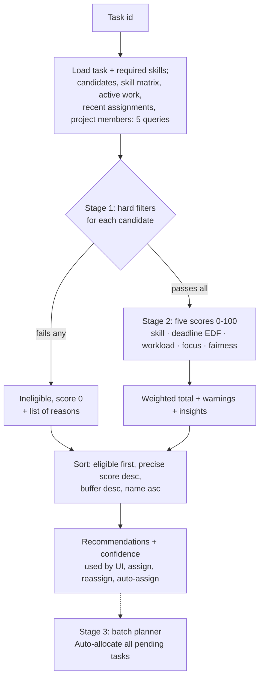

# 04 · Smart Allocation Algorithm (engine v2)

How the system chooses the best employee for a task, and how it shares out many tasks at once.
Sources: [allocationScoring.js](../../backend/src/services/allocationScoring.js) (pure maths, no imports) and [allocationEngine.js](../../backend/src/services/allocationEngine.js) (data loading, explanations). Related: [ALLOCATION_ENGINE.md](../ai/ALLOCATION_ENGINE.md).

---

## Overview



---

### Q: Explain your allocation algorithm in simple words.
**[Basic]** Three stages:
1. **Filter (yes/no).** Remove people who *cannot* do the task: wrong role, not approved/active, missing a required skill or below its minimum level, or not a project member when the project requires membership.
2. **Score (0–100).** Everyone left gets five explainable scores: **skill fit 35%**, **deadline fit 25%**, **workload balance 20%**, **focus 10%**, **fairness 10%**. Highest total first.
3. **Batch planning.** *Auto-allocate* shares out all pending tasks at once, serving the hardest-to-staff task first so that specialists end up where they are needed most.
The admin sees the ranking, all five bars, warnings, the projected finish date and a confidence badge, and can assign, press **Assign best match**, or run **Auto-allocate**.

### Q: What exactly are the hard eligibility filters?
**[Basic]**
1. Candidate SQL in `loadAllocationContext` ([allocationEngine.js](../../backend/src/services/allocationEngine.js) line 52): `u.approval_status = 'APPROVED' AND u.is_active = 1 AND e.is_active = 1 AND u.role = 'EMPLOYEE'`. Admins and pending users are never listed.
2. `ineligibilityReasons` (lines 117–128): for **every** required skill the employee must have it (`Lacks required skill: X`) with `numeric_score >= min_numeric_score` (`Insufficient proficiency in X (has 50, requires 75)`).
3. If `requires_membership = 1`, the employee must be in `project_members` ("Not a member of this project (membership required)").
Proficiency levels map to numbers: BEGINNER 25, INTERMEDIATE 50, ADVANCED 75, EXPERT 100 (a generated column in the DB).

### Q: What is the scoring formula?
**[Basic]**
```
total = 0.35·SkillFit + 0.25·DeadlineFit + 0.20·WorkloadBalance + 0.10·Focus + 0.10·Fairness
```
`WEIGHTS` is frozen on lines 26–32 of [allocationScoring.js](../../backend/src/services/allocationScoring.js); `scoreCandidate` (lines 158–177) computes all five and the weighted sum.

| Component | Formula (lines) | Meaning |
| --- | --- | --- |
| **SkillFit** | per skill `excess = (emp − req)/(100 − req)` in 0–1; score `100 − 25·|excess − target| / max(target, 1 − target)`; mean over skills, 100 if none (60–74) | 100 when the person's expertise matches what the priority deserves, 75 at the worst point |
| **DeadlineFit** | EDF simulation of the person's queue + the new task. On time `70 + 30·min(1, buffer/0.5)`; late `60·(1 − min(1, lateness/daysToDeadline))`; **−15 per existing task pushed past its deadline**; 0 if the deadline has passed (90–130) | Can they finish, and what does it cost their other work? |
| **WorkloadBalance** | `100·(1 − utilisation)`, `utilisation = (outstanding + taskHours) / (dailyCapacity · horizon)`, horizon = working days to the deadline clamped to 5–20 (135–140) | Load relative to capacity until the deadline |
| **Focus** | `100 − 15·activeTasks`, +10 if they already work on this project (142–143) | Context switching is expensive |
| **Fairness** | `100 / (1 + 0.5·Σ e^(−age/7))` over assignments of the last 30 days (146–149) | Rotates work; old picks fade |

Expertise targets by priority: CRITICAL 1.0, HIGH 0.75, MEDIUM 0.5, LOW 0.25 (`EXPERTISE_TARGET`, line 48).

### Q: Show a worked example with your seed data.
**[Intermediate]** Task 4 **"REST API for Task Allocation"**: **CRITICAL**, needs JavaScript ≥ ADVANCED (75) and Node.js ≥ ADVANCED (75), 20 h, deadline in 10 days, project 1 (no membership rule).

**Stage 1:**
| Employee | JS | Node.js | Result |
| --- | --- | --- | --- |
| John Doe | EXPERT 100 | EXPERT 100 | eligible |
| Nusrat Jahan | ADVANCED 75 | ADVANCED 75 | eligible |
| Alex Jones | ADVANCED 75 | — | ineligible: lacks Node.js |
| Rahim Uddin | INTERMEDIATE 50 | — | ineligible: insufficient JS, lacks Node.js |
| Jane Smith, Tanvir Ahmed | — | — | ineligible: lacks both |
| Sarah Khan | — | — | not listed (PENDING) |

**Stage 2** (fresh seed data):

| Score | John Doe | Nusrat Jahan | Why |
| --- | ---: | ---: | --- |
| Skill fit (35%) | 100 | 75 | CRITICAL → target excess 1.0. John is at the top of the scale; Nusrat is exactly at the minimum (excess 0), the furthest point |
| Deadline fit (25%) | 100 | 100 | Both finish well before the deadline (buffer 5 days vs 6.4 days) |
| Workload (20%) | 50 | 65 | Horizon ≈ 7.1 working days × 8 h ≈ 57 h. John: (8.5 h outstanding + 20) / 57 ≈ 50% used. Nusrat: 20 / 57 ≈ 35% |
| Focus (10%) | 95 | 100 | John has 1 active task (−15) but it is in the same project (+10) |
| Fairness (10%) | 75 | 91 | John received work more recently |
| **Total** | **86.9** | **83.3** | |

John ranks first with confidence **CLOSE** (margin 3.6 < 4). Nusrat wins on workload, focus and fairness, but for critical work the engine deliberately wants the expert. The same pair for a LOW-priority task would flip, because then Nusrat's "just qualified" profile is the ideal match. (Version 1 also picked John, with 92.)

### Q: What is "expertise conservation" and why is it in the skill score?
**[Intermediate]** If skill always rewarded "the more expert, the better", experts would win every task, including routine ones, and would be busy when a critical task arrives. v2 sets a **target** level of excess expertise per priority. A CRITICAL task's ideal person is the top expert; a LOW task's ideal person is just comfortably qualified (target 0.25). The score falls linearly to 75 as the person moves away from the target. Because it never drops below 75 for an eligible person, skill fit **guides** the choice without overpowering workload and deadlines. A unit test checks both directions ("rewards expertise for critical work and conserves experts for routine work").

### Q: What is EDF and why do you simulate it?
**[Hard]** **Earliest Deadline First**: a worker does their tasks in deadline order. `simulateEdf` (lines 90–101) sorts the person's active tasks plus the new one by deadline, accumulates remaining hours, and converts hours to calendar days with `dailyCapacity · 5/7` per day. That gives each task a projected finish time and lateness.
Why EDF: **Jackson's rule** (1955) proves that on a single machine, ordering by earliest due date **minimises the maximum lateness**. So EDF is the best a person could do with their queue; if a task is late even under EDF, it is genuinely infeasible for that person. It also gives the UI a meaningful "projected finish" and "buffer".
Ties: the new task goes *after* existing tasks with the same deadline (line 92), so it never jumps the queue.

*Teacher may follow up: "Is EDF optimal for anything else?"* — It minimises maximum lateness, not total lateness or the number of late jobs (that is Moore–Hodgson). Maximum lateness is the right goal here: one very late task is worse than several slightly late ones.

### Q: What is the displacement penalty?
**[Hard]** Adding a short, urgent task to someone's queue can push their *other* work past its deadline. Old v1 only asked "can they do this task?". v2 runs EDF **before and after** inserting the task (`deadlineFit`, lines 108–130) and counts existing tasks that were on time before and are late after. Each costs **15 points**. The UI shows them as warnings ("Would push "X" past its deadline"). A test checks it ("detects existing work that a new task would push past its deadline").

### Q: Why these weights (35/25/20/10/10)?
**[Intermediate]** They are a **reasoned heuristic**, not learned from data:
- **Skill fit 35%**: the largest single factor because it most affects quality. Eligibility already guarantees the minimum, so this only decides *how good a match* the person is.
- **Deadline fit 25%**: missing deadlines is the most visible failure, and the EDF model makes this score trustworthy.
- **Workload 20% + focus 10% + fairness 10% = 40%** together, more than skill: this pushes work to people with room and spreads it over time.
The weights sum to 1, so the total stays on 0–100; a unit test checks this ("weights sum to 1").

### Q: How can the weights and constants be changed?
**[Basic]** All tunables are exported constants at the top of [allocationScoring.js](../../backend/src/services/allocationScoring.js): `WEIGHTS`, `EXPERTISE_TARGET`, `FAIRNESS_DECAY_DAYS` (7), `DISPLACEMENT_PENALTY` (15), `FOCUS_PENALTY_PER_TASK` (15), `SAME_PROJECT_FOCUS_BONUS` (10), `HORIZON_WORKING_DAYS` (5–20), `PRIORITY_URGENCY`. The 30-day fairness window is `FAIRNESS_WINDOW_DAYS` in allocationEngine.js. The API returns `weights` and `algorithmVersion` ("2.0"). They are **not** editable from the UI; a super-admin setting is possible future work.

### Q: How are ties broken?
**[Intermediate]** `sortRecommendations` ([allocationEngine.js](../../backend/src/services/allocationEngine.js) line 196): eligible first → higher **precise** score (one decimal, not the rounded one) → larger deadline buffer → name. The order is deterministic: same input, same output.

### Q: What does the confidence badge mean?
**[Intermediate]** `confidence(best, second)` (lines 180–185) compares the top two eligible scores: margin ≥ 10 → **CLEAR**, ≥ 4 → **GOOD**, < 4 → **CLOSE** ("Close call" in the UI), and **ONLY_OPTION** when one person is eligible. It tells the admin when the decision is a judgement call worth a human look (task 4 is CLOSE: 3.6 points).

### Q: Prove (or argue) that the allocation is fair.
**[Hard]**
- **Same rules for everyone**: one formula; inputs are skills, capacity, current work, deadlines, membership and recent assignments. Name only appears as the very last tie-break.
- **Self-balancing**: a new assignment raises the person's outstanding hours and active-task count and adds a fresh entry to their fairness history, so their workload, focus and fairness scores drop for the next task.
- **Explicit rotation**: the fairness score means the same person doesn't win every close call. Its exponential decay (`e^(−age/7)`) forgets old picks: today counts 1.0, a week ago ≈ 0.37, two weeks ≈ 0.14.
- **Respects personal capacity**: `daily_capacity_hours` per person (Rahim 7 h, Tanvir 6 h).
- **Transparent and accountable**: every score, warning and reason is visible; forced overrides are logged with `[override]`.
Limitation: fairness counts *how many* tasks people get, not *how interesting* they are.

### Q: What warnings and insights can the engine produce?
**[Basic]** Warnings (never blocking; `explain`, lines 137–192): "Deadline has already passed", "Projected to finish X after the deadline (only Yh free before it)", "Would push "T" past its deadline", "Assignment would exceed capacity over the planning horizon". Insights: projected finish date, buffer days, displaced tasks, utilisation %, shares project, recent assignments. Only Stage-1 failures block, and even those can be overridden with `force: true`.

### Q: How does the batch planner (Auto-allocate) work?
**[Hard]** `planBatch` (lines 214–305). Assigning tasks one by one in list order is **greedy**: an easy task early in the list can take the only specialist that a hard task later in the list needed. The planner uses **regret-based greedy** ordering (the idea of Vogel's approximation method):
```
repeat until no tasks are left:
    regret(task) = best score − second-best score   (100 if only one person can do it)
    key(task)    = regret + urgency (CRITICAL 30, HIGH 20, MEDIUM 10) + 15 if due in < 3 days
    pick the task with the highest key (a task nobody can do is reported as unassignable)
    give it to its best person; add the task to that person's queue
    re-score only tasks whose top-2 included that person
```
"Regret" is what we lose if that task's best person is taken by someone else. Serving the highest regret first protects tasks that have only one good option. `POST /api/tasks/auto-allocate` with `{ "dryRun": true }` returns the plan; without it, `taskService.autoAllocate` (lines 305–315) re-plans and applies every assignment inside **one transaction**, each recorded as `AUTO_ASSIGNED` with a notification.

### Q: Why is the batch planner fast? Explain the monotonicity argument.
**[Hard]** Giving a person one more task can only **lower** their score for every other task:
- workload: outstanding hours go up → utilisation up → score down;
- focus: active tasks +1 → −15 (the +10 same-project bonus can't outweigh it);
- fairness: one more recent assignment → score down;
- skill fit: unchanged;
- deadline fit: one more job in the EDF queue → finish times can only move later → buffer down.
So after a pick, only tasks whose **best or runner-up** was the chosen person can change their top two; for every other task, the top two people's scores are unchanged and everybody else only got worse. The planner therefore re-scans just those tasks (lines 297–301), and caches scores with a **per-person version counter** so unchanged pairs are never recomputed (lines 233–240).

**The exception** (documented in the code, lines 206–208): the displacement penalty is not strictly monotone. If an earlier pick already made one of the person's tasks late, that task no longer counts as "displaced" by the next insertion, so a penalty can disappear and a score can rise slightly. Then the incremental plan is a close approximation of a full re-scan; in the benchmarks the plans were identical.

### Q: What is the time complexity?
**[Hard]** Let E = eligible employees, S = required skills, A = active tasks per person, T = tasks in a batch.
- **One task's recommendations:** O(E · (S + A log A)): every candidate gets a skill check and an EDF sort of their queue. Data loading is a fixed **5 queries** regardless of E.
- **Batch plan:** O(T·E) scorings for the first pass, then a few re-scans per round, i.e. O(T·E + T²) scorings in practice; O(T²·E) cheap cached comparisons in the worst case.

Benchmarks with random data (laptop, Node 26):

| Tasks × people | Incremental top-2 planner | First draft (full scan + sort every round) | Avg. score: planner / in-order greedy |
| --- | --- | --- | --- |
| 50 × 100 | 15 ms | 38 ms | 89.7 / 89.4 |
| 200 × 300 | 108 ms | 2.3 s | 87.0 / 86.6 |
| 500 × 1,000 | 0.65 s | 94 s | 88.3 / 88.1 |

The average-score gain over in-order greedy is small because random data rarely has scarce specialists; the planner's real value is protecting tasks that only one person can do, which the "most constrained task first" test checks ("batch planner serves the most constrained task first (regret)").

### Q: Why not use the Hungarian algorithm for the batch?
**[Hard]** The Hungarian algorithm finds the **optimal one-to-one matching** for a **fixed** cost matrix in O(n³). Our problem breaks both assumptions:
- **Not one-to-one**: one person may take several tasks.
- **Scores are not fixed**: when someone takes a task, their workload, deadline and fairness scores for the remaining tasks change. A cost matrix computed up front is wrong after the first assignment.
You could approximate with min-cost flow over "capacity slots", but the costs would still ignore the EDF interaction between tasks in one person's queue. Regret-based greedy re-scores after every pick, stays explainable ("served first because only Rahim can do it"), and is fast. Honest note: it is a strong heuristic, **not a proven optimum**.

### Q: Why does auto-assign run the engine inside the transaction?
**[Intermediate]** So the decision and the write happen on the **same snapshot**. `autoAssignTask` ([taskService.js](../../backend/src/services/taskService.js) lines 290–298) computes the ranking with `tx` and assigns in the same `withTransaction`. Nobody can change workloads in between. Auto-allocate does the same: the dry run is only a preview; applying **re-plans inside the transaction**, so it is consistent even if data changed after the preview.

### Q: Does manual assignment also check eligibility?
**[Intermediate]** Yes. `assignWithin` (line 218) calls `assertAssignableEmployee` (exists, EMPLOYEE, active, approved; line 89) and `assertEligible` (line 100), which runs the engine and refuses an ineligible person unless `force` is true. Before the rebuild, assign accepted any id (audit defect #7).

### Q: Why use remaining hours instead of estimated hours?
**[Intermediate]** A 40-hour task that is 90% done barely loads its owner. `remaining = max(0, estimate − logged)` is used for the person's queue and for the new task (at least 0.5 h, `toScoringTask` line 100), so logging work frees capacity immediately. A test checks that John's load is 8.5 h, not 16 h ("uses remaining (not estimated) hours for workload").

### Q: Why calendar days × 5/7, and what does the model ignore?
**[Intermediate]** Deadlines are calendar dates, people work about 5 days in 7, so capacity per calendar day is `dailyCapacity · 5/7` (`hoursPerCalendarDay`, line 79). It is an average: it ignores which weekday it is, public holidays and leave. The model also assumes a person works one task at a time in EDF order. That is a model, not a promise; calendar-aware capacity is future work.

### Q: Why does the engine exclude the task being allocated from the person's load?
**[Intermediate]** `toScoringCandidate` (lines 106–114) filters `excludeTaskId` out of the candidate's active jobs **and** their recent assignments. During **reassignment** the current assignee already holds this task; without the exclusion they would be counted twice and look worse than they are.

### Q: Why not machine learning?
**[Hard]**
- **No training data**: a new system has no labelled history of "good" assignments.
- **Explainability**: managers must justify decisions; five visible scores are fully transparent.
- **Bias risk**: ML can learn historical favouritism.
- **Testability**: deterministic pure functions are easy to unit-test.
Future: once history exists (on-time rate, actual vs estimated hours), the **weights** could be tuned from data while keeping the same explainable formula.

### Q: What if nobody is eligible?
**[Basic]** Recommendations list everyone with failure reasons and `eligibleCount` 0. *Assign best match* returns **409** "No eligible employee found for this task. Review the required skills or add project members." (task 10, Video Editing). In Auto-allocate, such tasks appear under "no eligible person" and stay PENDING.

### Q: Can an employee manipulate the algorithm by adding skills to their own profile?
**[Hard]** Partly yes: employees may edit **their own** skill profile (`POST /employees/:id/skills`, allowed for self in [skillController.js](../../backend/src/controllers/skillController.js)). Someone could claim EXPERT. Mitigations today: admins see and can edit every profile, and history shows who did the work. A stronger design would make self-declared skills "pending verification" until an admin confirms them. Honest limitation.

### Q: How is the engine tested?
**[Intermediate]** [allocation.test.js](../../backend/tests/allocation.test.js), **16 tests**:
- **Pure core (10):** weights sum to 1; expertise conservation; EDF simulation; displacement detection; on-time 70–100 vs late < 60; utilisation horizon; time-decayed fairness; regret planner serves the most constrained task first; unassignable tasks reported; total = weighted sum of five components.
- **Live data (6):** membership rule; deadline-fit penalty; free, rested people preferred when skills are equal; remaining hours; 404 for an unknown task; auto-allocate preview (changes nothing) then apply (`AUTO_ASSIGNED`, PENDING count drops).
[workflow.test.js](../../backend/tests/workflow.test.js) adds ranking, forced assignment, auto-assign and the "nobody eligible" error.
