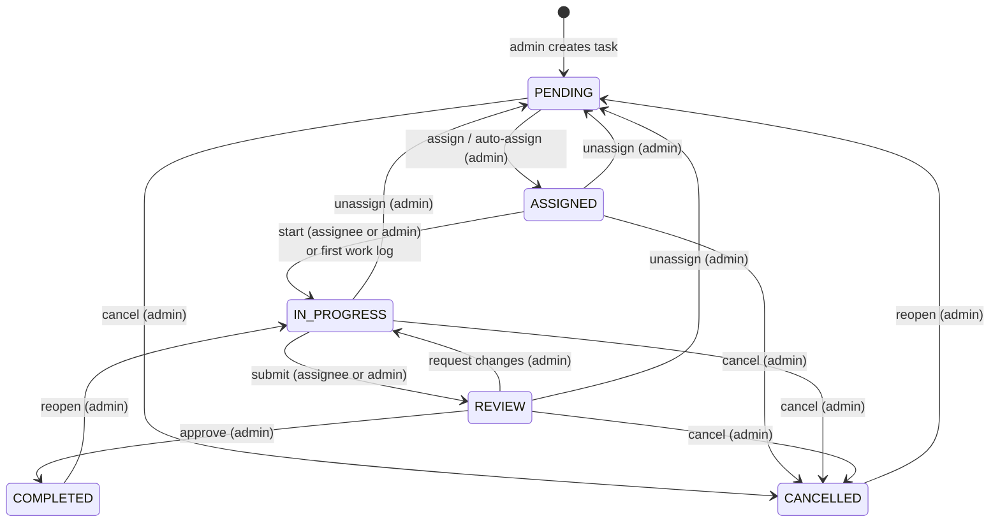

# 05 · Workflow and Business Rules

The task lifecycle, permissions, history, notifications and work-log rules.
Source: [taskService.js](../../backend/src/services/taskService.js). Related: [TASK_WORKFLOW.md](../ai/TASK_WORKFLOW.md).

---

## State machine



The status-change endpoint follows this table exactly ([taskService.js](../../backend/src/services/taskService.js) lines 25–32):
```js
export const TRANSITIONS = Object.freeze({
  PENDING: { CANCELLED: ['admin'] },
  ASSIGNED: { IN_PROGRESS: ['admin', 'assignee'], CANCELLED: ['admin'] },
  IN_PROGRESS: { REVIEW: ['admin', 'assignee'], CANCELLED: ['admin'] },
  REVIEW: { COMPLETED: ['admin'], IN_PROGRESS: ['admin'], CANCELLED: ['admin'] },
  COMPLETED: { IN_PROGRESS: ['admin'] },
  CANCELLED: { PENDING: ['admin'] }
});
```
`PENDING → ASSIGNED` and `→ PENDING` (unassign) are **not** in this table: they happen only through the assign/unassign endpoints, which do more than change the status.

---

### Q: What are the task statuses and what do they mean?
**[Basic]** `PENDING` (created, nobody assigned) → `ASSIGNED` (has an assignee, not started) → `IN_PROGRESS` (work started) → `REVIEW` (submitted, waiting for admin) → `COMPLETED` (approved). `CANCELLED` can be reached from any non-final state. `COMPLETED` and `CANCELLED` are **terminal** (`TERMINAL` on line 34): they cannot be edited or assigned.

### Q: Why did you implement a state machine instead of letting users set any status?
**[Intermediate]** Without rules, an employee could jump from ASSIGNED to COMPLETED and approve their own work, or a cancelled task could suddenly be "in progress". The state machine:
- lists every legal transition in **one place** (a data table, easy to read and change);
- attaches **who** may do each transition (`admin` or `assignee`);
- returns `allowedTransitions` for the current user in `GET /tasks/:id` (lines 61–66), so the UI shows exactly the right buttons.
The original code had no status endpoint at all, so tasks could never be completed (audit defect #8).

### Q: How does `changeStatus` check a transition step by step?
**[Intermediate]** Lines 169–214, inside one transaction:
1. Load the task (404 if missing).
2. User must be admin or the current assignee → otherwise 403.
3. Same status → 400 "Task is already X".
4. `TRANSITIONS[current][new]` must exist → otherwise 400 "Invalid status change".
5. The user's role must be in the allowed actors → otherwise 403 "Only an administrator can…".
6. Moving to IN_PROGRESS requires an assignee.
7. Cancelling closes the current assignment.
8. Update status (sets `completed_at` only for COMPLETED), write history, send notifications.

### Q: Can an employee approve their own task?
**[Basic]** No. `REVIEW → COMPLETED` is `['admin']` only. A test checks that John gets **403** when he tries ([workflow.test.js](../../backend/tests/workflow.test.js) "enforces the status state machine").

### Q: Who can do what? (permission matrix)
**[Basic]**

| Action | Who | Extra conditions |
| --- | --- | --- |
| Create / edit task | Admin | project exists and not archived; deadline in the future; skills exist; terminal tasks can't be edited |
| Delete task | Admin | only PENDING or CANCELLED; files deleted from disk too |
| Assign / auto-assign | Admin | task open and unassigned; employee eligible (or `force`) |
| Reassign | Admin | task assigned to someone else; status kept; reason stored |
| Unassign | Admin | any non-terminal task; goes back to PENDING |
| Start / submit | Assignee or admin | per state machine |
| Approve / request changes / reopen / cancel | Admin | per state machine |
| Log work | **Current assignee only** | task ASSIGNED or IN_PROGRESS; date not in the future; ≤ 24 h per person per day |
| Delete work log | Owner or admin | owner not after COMPLETED |
| Comment | Admin or current/past assignee | 1–2000 characters |
| Upload file | Admin or current assignee | not on CANCELLED; ≤ 5 files per request |
| Delete file | Uploader or admin | uploader not after COMPLETED |
| View task | Admin, or anyone ever assigned | past assignees keep read-only access |

### Q: How does the system decide if a user is "the assignee"?
**[Basic]** `isAssignee(task, user)` (lines 40–41): the user must have an employee profile and `task.assigned_employee_id === user.employeeId`, where `assigned_employee_id` comes from the **current** assignment row (`is_current = 1`).

### Q: What happens to the status when you reassign a task?
**[Intermediate]** It is **kept**. The comment on line 226 says: "Reassigning keeps in-flight work in progress; a fresh assignment starts at ASSIGNED." So an IN_PROGRESS task stays IN_PROGRESS with the new person. The old assignment row is closed with the reason, the new one is inserted, history says "Reassigned from A to B. Reason: …", and both people are notified.

### Q: What happens when you unassign?
**[Basic]** `unassignTask` (lines 277–287): closes the current assignment, sets status to **PENDING**, writes history `UNASSIGNED`, and notifies the previous assignee. Work logs stay (they belong to the task), so remaining hours are still correct when it is reassigned.

### Q: What happens when a task is cancelled?
**[Basic]** The current assignment is closed with reason "Task cancelled" (so it no longer counts in anyone's workload), status becomes CANCELLED, history is written and the assignee is notified. A cancelled task can be **reopened** to PENDING by an admin, then reassigned or deleted. A test covers cancel → reopen → delete.

### Q: Why can only PENDING or CANCELLED tasks be deleted?
**[Intermediate]** To protect real work records. A task with work logs, review history or an active person should not disappear by mistake. The admin must first cancel it (an explicit, logged decision). On delete, `ON DELETE CASCADE` removes the task's rows, and then the attachment files are removed from disk ([taskService.js](../../backend/src/services/taskService.js) lines 152–165).

### Q: What does logging work do automatically?
**[Intermediate]** If the task is ASSIGNED, the **first work log** moves it to IN_PROGRESS and writes an extra history line "ASSIGNED → IN_PROGRESS (first work log)" (lines 323–326). Logging hours also lowers `remaining_hours`, which lowers the employee's workload in the allocation engine.

### Q: Explain the 24-hours-per-day work log rule.
**[Intermediate]** Two levels:
1. Per entry: Zod requires `0 < hoursWorked ≤ 24`, and the DB has `CHECK (hours_worked > 0 AND hours_worked <= 24)`.
2. Per person per day (lines 315–318): the service sums all hours the employee already logged on that date **across all tasks** and refuses if `already + new > 24`:
```js
const alreadyLogged = await workLogRepository.sumHoursForEmployeeOnDate(user.employeeId, workDate, tx);
if (alreadyLogged + hoursWorked > 24) throw badRequest(`You already logged ${alreadyLogged}h on ${workDate}; total cannot exceed 24h.`);
```
It runs inside the transaction, so two parallel requests cannot both pass the check.

### Q: Why can the work date be "tomorrow"?
**[Hard]** Dates are compared in UTC. A user in Bangladesh (UTC+6) at 2 a.m. local time is still on "yesterday" in UTC. To allow "today" in any timezone ahead of UTC, the latest allowed date is **tomorrow's UTC date** (lines 311–313). The trade-off: a user behind UTC could log one day ahead. Storing the user's timezone would make this exact.

### Q: What is recorded in the task history?
**[Basic]** Every change writes a `task_history` row with the actor, action and details, inside the same transaction. Actions: `CREATED, UPDATED, ASSIGNED, AUTO_ASSIGNED, REASSIGNED, UNASSIGNED, STATUS_CHANGED, WORK_LOGGED, WORK_LOG_DELETED, ATTACHMENT_ADDED, ATTACHMENT_REMOVED`. Forced assignments add `[override]`; auto/manual assignment details include the score, e.g. "Assigned to Nusrat Jahan (EMP007) (score 88)".

### Q: Can history be edited or deleted?
**[Intermediate]** There is **no API** to edit or delete history rows. It is append-only from the application's point of view. It is deleted only together with its task (cascade), and only PENDING/CANCELLED tasks can be deleted. Someone with direct file access could still change the `.db` file; real tamper-proofing would need e.g. hash-chained log entries.

### Q: Which events create notifications, and who receives them?
**[Basic]**

| Event | Recipient | Type |
| --- | --- | --- |
| Self-registration | all admins | `REGISTRATION` |
| Account approved / created by admin | the user | `ACCOUNT_APPROVED` / `ACCOUNT_CREATED` |
| Registration rejected | the user (**e-mail only**, they can't log in) | `ACCOUNT_REJECTED` |
| Role changed | the user | `ROLE_CHANGED` |
| Password reset by admin / via link | the user | `PASSWORD_RESET` / `PASSWORD_CHANGED` |
| Task assigned | new assignee | `TASK_ASSIGNED` |
| Reassigned / unassigned | previous assignee | `TASK_UNASSIGNED` |
| Employee starts work | all admins | `TASK_STARTED` |
| Submitted for review | all admins | `TASK_REVIEW` |
| Approved / changes requested / cancelled / edited | assignee | `TASK_COMPLETED` / `TASK_CHANGES_REQUESTED` / `TASK_CANCELLED` / `TASK_UPDATED` |
| Comment | admin comment → assignee; employee comment → admins | `COMMENT` |
| File uploaded | admin upload → assignee; employee upload → admins | `ATTACHMENT` |

`notifyMany` removes duplicates and empty ids (`new Set(userIds.filter(Boolean))`). Each notification may also queue an e-mail (see [07-email-system.md](07-email-system.md)).

### Q: Are notifications part of the same transaction as the change?
**[Intermediate]** For tasks, assignments, approvals, role changes and resets: **yes**, they receive `tx`, so a failed operation creates no notification and no e-mail. Two small exceptions: creating a **comment** and an **admin password reset** write the record and the notification as separate statements (not one transaction). The risk is tiny (the notification could be missing if the second statement failed), but wrapping them in `withTransaction` would be cleaner.

### Q: Can an admin edit a task while someone is working on it?
**[Basic]** Yes, unless it is COMPLETED or CANCELLED. The assignee gets a `TASK_UPDATED` notification, and history lists which fields changed ("Updated: title, deadline").

### Q: Can a task be moved to an archived project, or created in one?
**[Basic]** No. `assertProjectUsable` returns 400 "Cannot add tasks to an archived project", and `loadAssignableTask` refuses to assign tasks of an archived project (409).

### Q: Why must a new deadline be in the future?
**[Basic]** A task created with a past deadline is immediately overdue and its DeadlineFit is 0 for everybody, which is almost always a typing mistake. On **update**, the check runs only if the deadline actually changes, so you can still edit other fields of a task that is already overdue.

### Q: What edge cases did you handle in the workflow?
**[Hard]**
- Assigning an already assigned task → 409 "Use reassignment instead".
- Reassigning to the same person → 400.
- Starting work with no assignee → 400.
- Logging work on a REVIEW/COMPLETED task → 409.
- Non-assignee logging work → 403.
- A promoted employee (now ADMIN) is no longer an allocation candidate, and the role-change response warns if they still have active tasks.
- Deleting a skill required by a task → 409.
- Non-numeric ids (`/tasks/abc`) → 400 instead of a crash.
- Employee requesting `/tasks?employeeId=4` still only gets their own tasks (the server overrides the filter, [taskController.js](../../backend/src/controllers/taskController.js) line 19).

### Q: What does "past assignees keep read-only access" mean and why?
**[Intermediate]** After reassignment, the previous assignee can still open the task, its history and comments (`wasEverAssigned`), but cannot log work, change status or upload files (those need *current* assignee). They may need to answer questions about work they did, and their logged hours remain part of the task.

### Q: Where is the "note" used when requesting changes?
**[Basic]** The status endpoint accepts an optional `note` (max 500). It is added to the history line ("REVIEW → IN_PROGRESS — Add error handling") and to the "Changes requested" notification. The UI **requires** a note for REVIEW → IN_PROGRESS ([TaskDetailPage.jsx](../../frontend/src/pages/tasks/TaskDetailPage.jsx) `needsNote`); the API keeps it optional.
