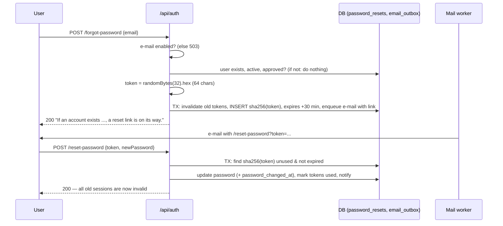

# 06 · Security

Authentication, authorisation, input handling, files, secrets and password recovery — with honest limitations.

---

## Passwords

### Q: How are passwords stored?
**[Basic]** Never in plain text. [authService.js](../../backend/src/services/authService.js) line 17 hashes them with **bcrypt** (`bcryptjs`) using `env.BCRYPT_ROUNDS` (default **10**, [env.js](../../backend/src/config/env.js) line 24). The stored value looks like `$2a$10$<22-char salt><31-char hash>`: it contains the algorithm, cost and a random **salt**. Login uses `bcrypt.compare`.

### Q: What does "cost 10" mean?
**[Intermediate]** bcrypt repeats its key setup 2^cost times. Cost 10 = 1,024 rounds ≈ tens of milliseconds per hash on a normal CPU. That is invisible for one login, but makes brute force very slow (an attacker can try only thousands of guesses per second instead of billions). Each +1 doubles the time. The tests use cost 4 to run fast ([setupEnv.js](../../backend/tests/setupEnv.js)).

### Q: Why bcrypt and not SHA-256 or MD5?
**[Intermediate]** SHA-256 and MD5 are designed to be **fast**; a GPU can compute billions per second, so leaked hashes of weak passwords are cracked quickly. bcrypt is **slow on purpose** (adjustable cost) and **salted** automatically (same password → different hash, so rainbow tables don't work). Modern alternatives are Argon2 or scrypt (also memory-hard).

### Q: Why `bcryptjs` and not `bcrypt`?
**[Basic]** `bcrypt` is a native C++ module; on modern Node it failed to install, so the original server could not start (audit defect #2). `bcryptjs` is pure JavaScript and produces the same hash format.

### Q: Why do you compare against a "dummy hash" when the e-mail doesn't exist?
**[Hard]** [authService.js](../../backend/src/services/authService.js) lines 15 and 113:
```js
const passwordOk = await bcrypt.compare(password, user ? user.password_hash : DUMMY_HASH);
```
If we returned immediately for unknown e-mails, "unknown e-mail" would answer in ~1 ms but "wrong password" in ~50 ms. An attacker could measure this and learn which e-mails have accounts (**user enumeration by timing**). Always running bcrypt makes both cases take similar time, and both return the same message "Invalid email or password."

### Q: What are the password rules?
**[Basic]** 6–128 characters ([schemas.js](../../backend/src/validators/schemas.js) line 47). Registration and change-password require a matching confirmation; the new password must differ from the current one. Honest note: 6 characters is a low minimum, chosen for demo convenience; production should require 10–12+ and check against breached-password lists.

---

## JWT authentication

### Q: How does login work?
**[Basic]** `POST /api/auth/login` → find user by e-mail (lower-cased) → bcrypt compare → refuse if PENDING, REJECTED or inactive (403 with reason) → sign a JWT `{ id, role }` with `JWT_SECRET`, expiry `JWT_EXPIRES_IN` (default 24 h) → return `{ token, expiresIn, user }`. The frontend stores the token and sends `Authorization: Bearer <token>` on every request.

### Q: What is a JWT and what is inside yours?
**[Basic]** A JSON Web Token = `header.payload.signature`, base64url-encoded. The signature (HMAC-SHA256 with `JWT_SECRET`) proves the server created it and nobody changed it. Our payload is only `{ id, role, iat, exp }` (line 19). The payload is **not encrypted** — anyone can read it — so we put no secrets in it.

### Q: JWT is stateless — so how can you log someone out or block them?
**[Hard]** We are **not purely stateless**: `authenticate` ([authMiddleware.js](../../backend/src/middleware/authMiddleware.js) lines 22–62) verifies the signature **and then reloads the account from the database on every request**:
- user deleted → 401; `is_active = 0` → 403; not APPROVED → 403;
- **password changed after the token was issued → 401**.
So deactivating an account blocks it **immediately** (tested: "deactivation takes effect immediately on existing tokens"). "Logout" on the client simply deletes the token from storage; "log out everywhere" = change the password. Cost: one small indexed query per request, which is cheap.

### Q: Explain the `iat` comparison for session revocation.
**[Hard]**
```js
// authMiddleware.js line 48
if (account.password_changed_at && decoded.iat < Date.parse(`${account.password_changed_at.replace(' ', 'T')}Z`) / 1000) {
  throw unauthorized('Your password was changed. Please sign in again.');
}
```
- `iat` ("issued at") is set by `jwt.sign`, in **seconds** since 1970.
- `password_changed_at` is stored by `updatePassword` as UTC text `YYYY-MM-DD HH:MM:SS` ([userRepository.js](../../backend/src/repositories/userRepository.js) line 37). The code turns it into ISO with `Z` (UTC), parses to milliseconds and divides by 1000.
- If the token was issued **before** the password change → rejected. So a password change or reset signs out **all** other sessions.
- `changePassword` returns a **new token** signed after the change, so the user who changed it stays logged in (lines 140–149).
- Edge case: both have 1-second resolution and the check is `<`, so a token issued in the *same second* as the change is still accepted. That is why the tests wait 1.1 s before resetting.

### Q: What happens if `JWT_SECRET` changes?
**[Hard]**
1. Every existing token fails `jwt.verify` → everyone gets 401 and must log in again (the frontend's 401 handler logs them out cleanly).
2. If `SETTINGS_SECRET` is not set, it defaults to `JWT_SECRET` ([env.js](../../backend/src/config/env.js) line 29), so the key that encrypts the **SMTP password** also changes. The stored password can't be decrypted any more; the settings page shows `passwordReadable: false` and the super admin must re-enter it.
Rotating `JWT_SECRET` is therefore a way to log out everyone, but set `SETTINGS_SECRET` separately to avoid the side effect.

### Q: What protects `JWT_SECRET` in production?
**[Intermediate]** [env.js](../../backend/src/config/env.js) lines 12–15: with `NODE_ENV=production`, the server **refuses to start** if `JWT_SECRET` is missing or shorter than 32 characters. In development there is a fallback secret. **Honest problem:** `backend/.env` is committed to the repository, so the development secret is public. That is acceptable for a demo but must never happen in production (use a secret manager or untracked `.env`).

### Q: Why are tokens valid for 24 hours, and is there a refresh token?
**[Intermediate]** 24 h means a user logs in once per working day. There is **no refresh token**. Because the account is re-checked on every request, a long-ish lifetime is less risky (we can still block a user). A production design would use short access tokens (15 min) + a rotating refresh token in an httpOnly cookie.

---

## Authorisation (RBAC)

### Q: How is role-based access control implemented?
**[Basic]** Two layers:
1. **Route level**: `requireAdmin` (ADMIN or SUPER_ADMIN) and `requireSuperAdmin` middleware ([authMiddleware.js](../../backend/src/middleware/authMiddleware.js) lines 64–72), e.g. `router.use(authenticate, requireAdmin)` for all `/admin` and `/reports` routes, `requireSuperAdmin` for `/settings`.
2. **Object level** (ownership) in controllers/services: employees only see tasks they are/were assigned to (`getTaskForUser`), only their own profile/skills/work logs, only delete their own comments/logs/files.

### Q: Can an employee change their own role through the API?
**[Hard]** No:
- `PATCH /admin/users/:id/role` is behind `requireAdmin`, so an employee gets 403.
- Inside `changeRole`, only `SUPER_ADMIN` may proceed (line 93), and `assertCanManage` forbids changing **your own** account (lines 18–23).
- The employee's own update route `PATCH /auth/profile` only accepts `fullName` and `phoneNumber` (Zod `updateProfileSchema`); extra fields like `role` are stripped by Zod.
- The JWT contains `role`, but the server **ignores the token's role** and uses the role from the DB, so editing the token is useless (and breaks the signature anyway).

### Q: What was the privilege-escalation bug you fixed?
**[Hard]** In an earlier version, `changeRole` only protected **super-admin targets**: a regular ADMIN could not edit a super admin, but **could promote any employee — or another admin — to SUPER_ADMIN**. Two admins could even promote each other. Fix ([adminController.js](../../backend/src/controllers/adminController.js) lines 90–120): role changes are **super-admin only**, nobody can change their own role, the account must be approved, and the last active super admin cannot be demoted. Tests: "does not let a regular admin change anyone's role (no self-made super admins)" and "never lets a super admin change their own role" in [uploads.test.js](../../backend/tests/uploads.test.js). Listed in [AUDIT_REPORT.md](../ai/AUDIT_REPORT.md) "Follow-up fixes".

### Q: How do you protect the last super admin?
**[Intermediate]** `countActiveSuperAdmins()` counts super admins that are active and approved. Demoting (`changeRole`, line 98) or deactivating (`setActive`, line 127) a super admin is refused with 409 "At least one active super admin must remain" if the count is ≤ 1. Combined with "you can't manage yourself", the system can never lose its last super admin through the API. (Limitation: the count is not inside the same transaction as the update, see [03-database.md](03-database.md).)

### Q: What can an ADMIN not do that a SUPER_ADMIN can?
**[Basic]** Change roles; create ADMIN/SUPER_ADMIN accounts; activate/deactivate/reset password of a super admin; configure e-mail settings and see the outbox.

### Q: The frontend hides admin pages. Isn't that enough?
**[Basic]** No. Hiding is only for user experience. Anyone can call the API with curl or Postman. **Every rule is enforced on the server**; the React guards (`RequireAdmin`, `RequireSuperAdmin` in [App.jsx](../../frontend/src/App.jsx)) just avoid showing pages that would return 403.

---

## Injection and XSS

### Q: How do you prevent SQL injection?
**[Basic]** All SQL uses **parameterised queries**: values are passed as `?` parameters and bound by SQLite (`stmt.bind(params)` in [db.js](../../backend/src/config/db.js)), never concatenated into SQL. Search uses `LIKE ?` with `%${search}%` as the parameter value. Dynamic `UPDATE … SET` lists (e.g. `updateTaskFields`) build column names only from a **fixed allow-list** in code, never from user keys. Inputs are also validated by Zod first.

### Q: Is there any place where a value is put directly into SQL text?
**[Hard]** Only trusted, non-user values: `PRAGMA user_version = ${version}` uses the loop counter in migrations; `migrate.js` uses table names read from `sqlite_master`; repository code adds constant fragments like `AND is_read = 0`. No request data is ever interpolated.

### Q: How do you prevent XSS (cross-site scripting)?
**[Intermediate]**
- **React escapes** everything rendered with `{value}`; the app never uses `dangerouslySetInnerHTML` for user content.
- **E-mail HTML** is built by [emailTemplates.js](../../backend/src/utils/emailTemplates.js), which runs every value (title, message, names, link, footnote) through `escapeHtml` (lines 40–41), so a task called `<script>` appears as text in the e-mail.
- **E-mail preview** in the admin UI is shown in `<iframe sandbox="" srcDoc=…>` ([EmailSettingsPage.jsx](../../frontend/src/pages/settings/EmailSettingsPage.jsx) line 542): an empty `sandbox` disables scripts, forms and same-origin access.
- **Uploads**: HTML/SVG/JS files are not on the whitelist, and files are served with `Content-Disposition: attachment` except images/PDF.
- **Helmet** sets security headers (including a Content-Security-Policy on API responses and `X-Content-Type-Options: nosniff`).

### Q: Do you protect against CSRF?
**[Intermediate]** CSRF attacks rely on the browser automatically sending **cookies**. We send the JWT in the `Authorization` header from JavaScript, which a foreign site cannot do, so classic CSRF does not apply. (If we moved the token into a cookie, we would need `SameSite` cookies and/or CSRF tokens.)

---

## File uploads

### Q: How are file uploads secured?
**[Intermediate]** [upload.js](../../backend/src/middleware/upload.js):
- **Whitelist**: both the MIME type and the extension must match an allowed pair (images, PDF, txt/md/log, csv, json, zip, Office). `evil.exe` sent as `image/png` → 400 (lines 57–64).
- **Random file names**: `crypto.randomBytes(16).toString('hex') + ext` (line 53). The user's original name is only metadata in the DB, never part of a path → no path traversal, no overwriting, no guessing.
- **Size limits**: attachments `MAX_UPLOAD_MB` (default 10 MB) and max 5 files per request; avatars 2 MB, 1 file, images only. Over the limit → 413.
- **Permission checks** happen after multer saved the file; on any error the global error handler **deletes** the saved files (`cleanupRequestFiles`).
- **Downloads** require task access; `inline` display only for images and PDF (`INLINE_TYPES`, [attachmentController.js](../../backend/src/controllers/attachmentController.js) line 12); everything else is forced to download. The file name is sent with `filename*=UTF-8''<encoded>` to avoid header injection.

### Q: How do you stop path traversal on the public avatar URL?
**[Hard]** Avatars are public (`GET /api/files/avatars/:name`) so `` tags work without a token. The name must match a strict regex ([attachmentController.js](../../backend/src/controllers/attachmentController.js) line 110):
```js
const AVATAR_NAME = /^[a-f0-9]{32}\.(png|jpe?g|gif|webp)$/;
```
So `..%2F..%2F.env` → 404 (tested: "refuses path tricks on the public avatar route"). Also `removeUploadedFile` uses `path.basename` (line 77) so even a bad stored name can't escape the folder. The 128-bit random name makes photos unguessable.

### Q: Do you check the real file content (magic bytes)?
**[Hard]** No — honest limitation. We trust the client's MIME type + extension pair. Risk is reduced because files are stored under random names outside the web root, never executed, served with the stored MIME type, `nosniff`, and non-image/PDF files are forced to download. Adding magic-byte detection (e.g. the `file-type` package) and a virus scan would be the next step.

---

## Other protections

### Q: What rate limiting do you have?
**[Basic]** [rateLimiters.js](../../backend/src/middleware/rateLimiters.js) (express-rate-limit, per IP): login, register, forgot-password and reset-password are limited to **50 requests per 15 minutes**; the whole `/api` is limited to **600 per minute**. Disabled in tests. Limitation: counters are in memory (reset on restart, not shared between servers).

### Q: What does Helmet do?
**[Basic]** `app.use(helmet())` ([app.js](../../backend/src/app.js) line 28) sets HTTP security headers: `Content-Security-Policy`, `X-Content-Type-Options: nosniff`, `X-Frame-Options`/frame-ancestors (anti-clickjacking), `Strict-Transport-Security`, `Referrer-Policy`, and more. We also disable `X-Powered-By` so attackers don't see "Express".

### Q: How is CORS configured?
**[Intermediate]** [app.js](../../backend/src/app.js) lines 31–41: in development any origin is accepted (Vite may use different ports); in **production** only origins in `ALLOWED_ORIGINS` are allowed. Requests without an `Origin` header (same-origin, curl) are allowed. In normal use the frontend is same-origin (Vite proxy or Express serving `dist`), so CORS is rarely needed.

### Q: What other input limits exist?
**[Basic]** JSON body max **100 KB** (line 43); Zod limits on every string (titles 200, comments 2000, notes 500…), numbers (estimated hours ≤ 1000, capacity ≤ 24), arrays (≤ 20 required skills); ids must be positive integers (`parseId`) → 400 instead of a crash.

### Q: Do error messages leak internal details?
**[Basic]** No. Unknown errors return "Internal server error occurred." with status 500; the stack trace is only printed in the server console ([errorHandler.js](../../backend/src/middleware/errorHandler.js) line 62). SQLite constraint errors are translated into neutral messages.

---

## Secrets

### Q: How is the SMTP password stored?
**[Hard]** Encrypted with **AES-256-GCM** ([secretBox.js](../../backend/src/utils/secretBox.js)):
- Key = `SHA-256("smart-workflow-settings:" + SETTINGS_SECRET)` → 32 bytes (line 11). `SETTINGS_SECRET` defaults to `JWT_SECRET`.
- Each encryption uses a fresh random 12-byte IV; GCM produces an authentication **tag** that detects tampering.
- Stored as `v1:<iv>:<tag>:<ciphertext>` (base64). The `v1` prefix allows changing the scheme later.
- `decryptSecret` returns `null` if the key changed or data was modified.
- The API never returns the password; only `hasPassword` and `passwordReadable` ([emailSettingsController.js](../../backend/src/controllers/emailSettingsController.js) line 19).

### Q: If I copy the `.db` file, can I read the SMTP password?
**[Hard]** Not from the file alone: it holds only ciphertext; you also need `SETTINGS_SECRET` (or `JWT_SECRET`), which lives in the environment, not the database. **But** in this repository `backend/.env` (with `JWT_SECRET`) is committed to git, and `SETTINGS_SECRET` falls back to it — so someone with the repo **and** the DB could decrypt it. For production: keep `.env` out of git, set a separate random `SETTINGS_SECRET`, and ideally use a secret manager. Also, the DB copy would expose bcrypt password **hashes** (slow to crack, but still sensitive).

### Q: Why encryption for the SMTP password but hashing for user passwords?
**[Intermediate]** We **never need** a user's password back — we only check it — so a one-way hash is best. The SMTP password must be **sent to the mail server**, so we need the original value back → reversible encryption.

---

## Forgot password

### Q: How does the forgot-password flow work?
**[Intermediate]**

Code: [authService.js](../../backend/src/services/authService.js) lines 164–208, [emailRepository.js](../../backend/src/repositories/emailRepository.js) lines 175–191.

### Q: Why store only the SHA-256 hash of the reset token?
**[Hard]** The token works like a temporary password. If the database leaked (backup, copied file), plain tokens would let an attacker reset any account with a pending link. With only `sha256(token)` stored, the attacker can't reverse it. SHA-256 (fast) is fine here — unlike for passwords — because the token is **32 random bytes** (256 bits of entropy): brute force is impossible, so slowness adds nothing. The `token_hash` column is UNIQUE for fast lookup.

### Q: What makes the reset token safe?
**[Hard]**
- **Unpredictable**: `crypto.randomBytes(32)` (cryptographically secure).
- **Short-lived**: expires in `PASSWORD_RESET_TTL_MINUTES` = 30 min.
- **Single use**: `used_at` is set; `findValidResetToken` requires `used_at IS NULL AND expires_at > now`.
- **Newest wins**: creating a new token marks all older unused ones as used (tested: "a newer link invalidates the older one").
- **Strict format**: Zod requires exactly 64 hex chars, so garbage is rejected early.
- **Kills sessions**: the password update sets `password_changed_at`, so tokens stolen before are revoked.
- Only for active, approved accounts.

### Q: How do you avoid user enumeration in forgot-password?
**[Intermediate]** The endpoint returns the **same 200 message** whether or not the e-mail exists ("If an account exists for that e-mail, a reset link is on its way."). For unknown e-mails nothing is queued. Tested: "answers identically for unknown addresses and queues nothing". (The response time can differ slightly because known accounts write to the DB; rate limiting reduces this risk.)

### Q: Why does forgot-password return 503 sometimes?
**[Basic]** If e-mail is disabled by the super admin, a reset link cannot be delivered, so the API says so honestly (503) and the UI tells the user to ask an admin. `GET /auth/options` tells the login page whether to offer the feature. This reveals nothing about any account.

---

## OWASP Top 10 (2021) mapping

| OWASP risk | How this project addresses it | Remaining gap |
| --- | --- | --- |
| A01 Broken Access Control | `requireAdmin`/`requireSuperAdmin`, object-level checks, server-side employee scoping, last-super-admin rule, privilege-escalation fix, 18 RBAC tests | — |
| A02 Cryptographic Failures | bcrypt passwords, AES-256-GCM SMTP secret, SHA-256 reset tokens, JWT HMAC | No HTTPS config in the app (needs a reverse proxy); `.env` committed |
| A03 Injection | Parameterised SQL, allow-listed columns, Zod validation, HTML escaping in e-mails | — |
| A04 Insecure Design | State machine, transactions, outbox, eligibility rules, single-use tokens | Self-declared skills not verified |
| A05 Security Misconfiguration | Helmet, `x-powered-by` off, strict CORS in production, production refuses weak JWT secret | Dev defaults in committed `.env` |
| A06 Vulnerable Components | Maintained packages (Express 4, multer 2, nodemailer) | No automated `npm audit` in CI |
| A07 Identification & Auth Failures | Rate limits, timing-safe login, account re-check per request, revocation on password change | Short min password length, no 2FA |
| A08 Software & Data Integrity | Migrations versioned and backed up; GCM tag detects tampering | No signed audit log |
| A09 Logging & Monitoring | `task_history` audit trail, outbox log, server error log | No central logging / alerts |
| A10 SSRF | No user-supplied URLs are fetched; SMTP host is set only by a super admin | Super admin can point SMTP anywhere (trusted role) |
