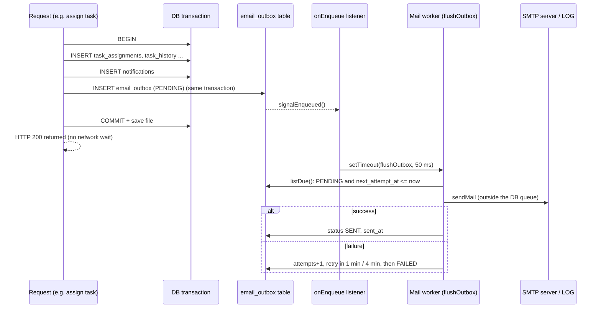

# 07 · E-mail System

Global SMTP settings, the transactional outbox, retries, and what happens when the mail server is down.
Sources: [mailService.js](../../backend/src/services/mailService.js), [emailRepository.js](../../backend/src/repositories/emailRepository.js), [notificationRepository.js](../../backend/src/repositories/notificationRepository.js), [emailTemplates.js](../../backend/src/utils/emailTemplates.js), [emailSettingsController.js](../../backend/src/controllers/emailSettingsController.js), [EmailSettingsPage.jsx](../../frontend/src/pages/settings/EmailSettingsPage.jsx).

---

## Outbox flow



---

### Q: Who configures e-mail and where?
**[Basic]** Only the **super admin**, on the page **E-mail settings** (`/app/settings/email`). All `/api/settings/email/*` routes use `authenticate, requireSuperAdmin` ([settingsRoutes.js](../../backend/src/routes/settingsRoutes.js)). The settings are global (one row, `email_settings.id = 1`, enforced by `CHECK (id = 1)`).

### Q: Which settings exist?
**[Basic]** Enabled on/off; transport (`LOG` or `SMTP`); SMTP host, port (default 587), security (STARTTLS on 587 or SSL/TLS on 465), username, password; sender name and address; reply-to; app URL (used to build links in e-mails); and a list of **disabled events**. The UI offers presets for Gmail, Outlook/Office 365, Mailtrap and Brevo.

### Q: Why store SMTP settings in the database and not in `.env`?
**[Intermediate]**
- The super admin can change them **at runtime from the UI**, without server access or a restart.
- They can be **tested before saving** (test button with unsaved values).
- Changes are audited (`updated_by`, `updated_at`).
- Secrets in the DB are protected: the password is encrypted with AES-256-GCM using a key from the environment, and the API never returns it.
Trade-off: the encryption key still comes from `.env` (`SETTINGS_SECRET`), so infrastructure secrets and app settings are split on purpose.

### Q: What is the difference between the LOG and SMTP transports?
**[Basic]**
- **LOG** (default): `nodemailer.createTransport({ jsonTransport: true })`. Nothing leaves the machine; the message is rendered, marked SENT, logged to the console (`[mail:LOG] → …`) and visible with a full HTML preview in the outbox. Perfect for demos and offline exams.
- **SMTP**: a real nodemailer SMTP transport with host, port, TLS and auth, with connection timeouts of 10 s and socket timeout 20 s ([mailService.js](../../backend/src/services/mailService.js) lines 26–40).
This is the **Strategy pattern**: the rest of the code doesn't care which transport is used.

### Q: What is the transactional outbox pattern, in simple words?
**[Intermediate]** Instead of sending the e-mail during the request, we **write it into a table (`email_outbox`) in the same database transaction** as the business change. A separate worker reads the table and sends the e-mails later.
- If the transaction commits → the change **and** the e-mail record both exist → the e-mail will be sent.
- If the transaction rolls back → neither exists → **no e-mail about something that didn't happen**.
Tested: "never sends mail for a rolled-back transaction" ([email.test.js](../../backend/tests/email.test.js)).

### Q: Why not just call `sendMail()` inside the request?
**[Hard]** Three problems:
1. **Slowness / blocking**: SMTP can take seconds or time out. Our DB uses a single exclusive queue; sending inside a transaction would **block every other user** for that time.
2. **Inconsistency**: if you send first and the transaction later fails, the user gets an e-mail about a change that was rolled back. If you commit first and then sending fails, the e-mail is lost forever (no retry).
3. **Coupling**: a mail server outage would make task assignment fail.
The outbox fixes all three: requests only do a fast INSERT; delivery happens later, outside the DB queue, with retries.

### Q: How does a notification turn into an e-mail?
**[Intermediate]** [notificationRepository.js](../../backend/src/repositories/notificationRepository.js) lines 5–9:
```js
export const createNotification = async (userId, title, message, type = 'INFO', ex = defaultExecutor) => {
  const result = await ex.query('INSERT INTO notifications (user_id, title, message, type) VALUES (?, ?, ?, ?)', [...]);
  await enqueueForUser(userId, { title, message, type }, ex);   // same executor = same transaction
  return result;
};
```
`enqueueForUser` ([emailRepository.js](../../backend/src/repositories/emailRepository.js) lines 86–101) checks: e-mail enabled? event not disabled? user exists and is active (unless `force`)? Then it renders the e-mail with `renderEmail` and inserts a PENDING outbox row. So **every in-app notification can also become an e-mail** with no extra code at the call sites.

### Q: How does the worker know there is new mail? (Observer pattern)
**[Intermediate]** `emailRepository` keeps a set of listeners. `insertOutbox` calls `signalEnqueued()` after inserting a PENDING row (line 78). `startMailWorker` subscribes with `onEnqueue(() => setTimeout(flushOutbox, 50))` ([mailService.js](../../backend/src/services/mailService.js) lines 131–137). The repository does not import the mail service — it just announces "something was queued" — so there is no circular dependency. The 50 ms delay lets the transaction commit first. There is also a **poll every 15 s** (`POLL_MS`) for retries that become due later.

### Q: Isn't there a risk that the listener fires before the commit?
**[Hard]** Yes, the signal is sent at INSERT time, before COMMIT. Two safeguards: (1) the 50 ms `setTimeout`; and more importantly (2) `flushOutbox` reads the outbox through the **exclusive queue**, which cannot run until the transaction (which holds the queue) has finished. If the transaction rolled back, the row doesn't exist and nothing is sent.

### Q: How does the worker process the outbox?
**[Intermediate]** `drain()` (lines 64–101): loop — take up to 20 due rows (`status = 'PENDING' AND next_attempt_at <= now`, oldest first), load settings, build the transport once, send each row, mark SENT or failed, close the transport; repeat until nothing is due. `flushOutbox()` (lines 107–125) makes sure only **one drain runs at a time**: a call during a run sets `kickAgain` so one more pass runs afterwards.

### Q: Explain the retry and exponential backoff.
**[Hard]** [mailService.js](../../backend/src/services/mailService.js) line 94:
```js
const retryInSeconds = attempt < MAX_ATTEMPTS ? 60 * 4 ** (attempt - 1) : null;   // MAX_ATTEMPTS = 3
```
| Attempt | Result if it fails |
| --- | --- |
| 1 | retry in 60 × 4⁰ = **1 minute** |
| 2 | retry in 60 × 4¹ = **4 minutes** |
| 3 | **FAILED** (no automatic retry) |

`markAttemptFailed` (lines 120–127) increments `attempts`, stores `last_error` (max 500 chars) and either sets `next_attempt_at = now + N seconds` (still PENDING) or status FAILED. **Exponential** backoff gives a temporary outage time to recover without hammering the server. Tested: "retries failed deliveries, then gives up until retried manually".

### Q: How does a manual retry work?
**[Basic]** In the outbox list, a FAILED message has a **Retry** button → `POST /settings/email/outbox/:id/retry` → `UPDATE … SET status='PENDING', attempts=0, last_error=NULL, next_attempt_at=now WHERE id=? AND status='FAILED'`, then the outbox is flushed. Retrying a non-failed message → 400. There is also **"Process now"** (`/outbox/flush`) and **clear log** (deletes SENT/FAILED rows; PENDING rows are never deleted).

### Q: What are per-event toggles?
**[Basic]** [emailTemplates.js](../../backend/src/utils/emailTemplates.js) defines `EMAIL_EVENTS` (19 types in groups Accounts, Tasks, Collaboration, System). The super admin can switch off individual events (e.g. "New comment"); they are saved in `disabled_events`. **Required** events (`PASSWORD_RESET_LINK`, `TEST`) can't be disabled (`isEventEnabled` lines 34–38). Unknown event names sent by a client are filtered out on save (`toRow`). Tested: "respects events switched off by the super admin".

### Q: How does "test e-mail with unsaved settings" work?
**[Intermediate]** `POST /settings/email/test { to, settings? }`. If `settings` is given, the controller converts the form values into a row, and uses the typed password or falls back to the stored one ([emailSettingsController.js](../../backend/src/controllers/emailSettingsController.js) lines 71–90). `sendTestEmail` merges them **over the saved settings in memory only**, calls `transport.verify()` for SMTP, sends immediately (bypassing the outbox so the admin sees the real error), and records the attempt in the outbox as SENT or FAILED. The saved configuration is **not changed** (the test checks this).

### Q: What is the note about Gmail app passwords?
**[Basic]** Gmail does not accept your normal Google password over SMTP. You must turn on **2-Step Verification** and create an **App password** (16 characters) in your Google account, then use `smtp.gmail.com`, port 587, STARTTLS, your Gmail address as username and the app password. The UI preset shows this hint.

### Q: What happens if the SMTP server is down when a task is assigned? Does assignment fail?
**[Hard]** **No.** The assignment transaction only inserts an outbox row, which is a local DB write. The request succeeds immediately. Later, the worker tries to send, fails (connection refused/timeout), and schedules retries at 1 and 4 minutes; after 3 attempts the message is FAILED with the error visible in the outbox. When SMTP is fixed, the super admin presses Retry. The in-app notification was created anyway, so the employee still sees it in the bell.

### Q: What if e-mail is disabled while messages are still pending?
**[Intermediate]** `drain()` marks them as failed with "E-mail sending was disabled before this message was delivered." (line 83). While e-mail is disabled, `enqueueForUser` creates no new outbox rows at all. When the settings are saved as enabled again, the controller calls `flushOutbox()` so anything pending goes out.

### Q: How is the e-mail content built, and is it safe?
**[Intermediate]** `renderEmail` (pure function, no I/O) returns `{ subject, text, html }`: a plain-text version and a simple table-based HTML layout (works in Outlook/Gmail). Every dynamic value goes through `escapeHtml`, so user-provided task titles can't inject HTML. Each event type has a default link path (e.g. TASK_ASSIGNED → `/app/tasks`), joined to the configured `app_url`.

### Q: Why does a rejected applicant get only an e-mail and not a notification?
**[Basic]** A rejected account can never log in to read in-app notifications. So `rejectRegistration` calls `enqueueForUser(..., { type: 'ACCOUNT_REJECTED', force: true })` directly ([adminController.js](../../backend/src/controllers/adminController.js) lines 56–64). `force` allows mailing an account that is not active/approved.

### Q: Is the e-mail worker running in tests?
**[Basic]** No. `EMAIL_WORKER` is false when `NODE_ENV=test` ([env.js](../../backend/src/config/env.js) line 31); tests call `flushOutbox()` directly so they are deterministic. It can also be turned off with `EMAIL_WORKER=off`; the outbox is then only processed on demand.

### Q: Can an e-mail be sent twice?
**[Hard]** Normally no: one drain at a time, and each row is marked SENT right after delivery. Edge case: if the process crashes **after** the SMTP server accepted the message but **before** `markSent` is saved, the row stays PENDING and will be sent again after restart. This is the usual **at-least-once** guarantee of the outbox pattern; exactly-once delivery over SMTP is not possible in general. For notification e-mails a rare duplicate is acceptable.

### Q: What are the limitations of the e-mail system?
**[Intermediate]**
- Only one worker per process; with several servers you would need row locking (`SELECT … FOR UPDATE SKIP LOCKED` in PostgreSQL).
- No bounce handling or unsubscribe link.
- No per-user e-mail preferences (only global per-event switches).
- HTML is a fixed template (no template editor).
